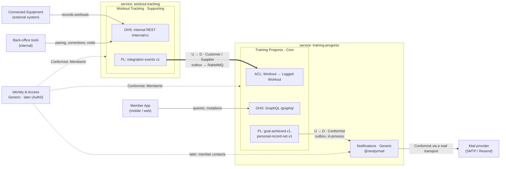

<p align="center">
  <a href="http://nestjs.com/" target="blank"></a>
</p>

[circleci-image]: https://img.shields.io/circleci/build/github/nestjs/nest/master?token=abc123def456
[circleci-url]: https://circleci.com/gh/nestjs/nest

  <p align="center">A progressive <a href="http://nodejs.org" target="_blank">Node.js</a> framework for building efficient and scalable server-side applications.</p>
    <p align="center">
<a href="https://www.npmjs.com/~nestjscore" target="_blank"></a>
<a href="https://www.npmjs.com/~nestjscore" target="_blank"></a>
<a href="https://www.npmjs.com/~nestjscore" target="_blank"></a>
<a href="https://circleci.com/gh/nestjs/nest" target="_blank"></a>
<a href="https://discord.gg/G7Qnnhy" target="_blank"></a>
<a href="https://opencollective.com/nest#backer" target="_blank"></a>
<a href="https://opencollective.com/nest#sponsor" target="_blank"></a>
  <a href="https://paypal.me/kamilmysliwiec" target="_blank"></a>
    <a href="https://opencollective.com/nest#sponsor"  target="_blank"></a>
  <a href="https://twitter.com/nestframework" target="_blank"></a>
</p>
  <!--[](https://opencollective.com/nest#backer)
  [](https://opencollective.com/nest#sponsor)-->


## Architecture

A fitness platform made of two NestJS microservices, designed with DDD. The full proposal is in [docs/architecture.md](docs/architecture.md), and the vocabulary is in [docs/ubiquitous-language.md](docs/ubiquitous-language.md).

| Bounded context | Subdomain | Runs in | API | Data |
|---|---|---|---|---|
| **Training Progress**: training log, progress summaries, streaks, personal records, training goals | Core | `apps/training-progress` | GraphQL, external | PostgreSQL instance 2, Redis cache |
| **Workout Tracking**: equipment, pairing, recording, correcting and voiding workouts | Supporting | `apps/workout-tracking` | REST, internal | PostgreSQL instance 1 |
| **Notifications**: mail about achievements, built on `@nestjs/mail` | Generic | a module in `apps/training-progress` | none | none of its own |
| **Calendar**: training period boundaries, built on `date-fns` | Generic | a value object in Training Progress | none | none |
| **Identity & Access** | Generic | later: an identity provider | | |

The services share no database and never call each other. Aggregates raise domain events, which are written to a transactional outbox (`@nestjs/outbox`) in the same transaction as the change. Inside a service, the outbox delivers them to policies that update other aggregates, one aggregate per transaction. Between contexts, only integration events in a published language travel: over RabbitMQ to the other service, and in-process to Notifications. Every consumer applies each event once, through its inbox.

### Context map



**Legend:** U = upstream, D = downstream, OHS = Open Host Service, PL = Published Language, ACL = Anticorruption Layer. There is no Shared Kernel: `libs/workout-tracking-contracts` holds only Workout Tracking's published language (event payloads and topic names), and `libs/ddd` only technical building blocks, never domain classes.

## Metrics

### Lambda → ECS + NestJS metrics mapping

| Lambda | ECS + NestJS equivalent | Where to find it |
|---|---|---|
| `Invocations` | `RequestCount` | `AWS/ApplicationELB` |
| `Duration` | `TargetResponseTime` (p50/p95/p99) | `AWS/ApplicationELB` |
| `Errors` | `HTTPCode_Target_5XX_Count` | `AWS/ApplicationELB` |
| `Throttles` | `RejectedConnectionCount`, 503s, CPU saturation | ALB + `AWS/ECS` |
| `ConcurrentExecutions` | `RunningTaskCount`, active requests per task | Container Insights, app metrics |
| `Max Memory Used` | `MemoryUtilization` | `AWS/ECS` (per service) |
| Cold start / `Init Duration` | Time for a task to start and pass health checks, plus Nest bootstrap time | ECS service events, app log |
| `REPORT` log line | Nothing automatic; log each request from a NestJS interceptor | CloudWatch Logs (`awslogs` driver) |
| X-Ray | OpenTelemetry + ADOT collector sidecar → X-Ray | X-Ray / CloudWatch |
| Lambda Insights | Container Insights (per-task CPU, memory, network) | `ECS/ContainerInsights` |

## Project setup

```bash
$ pnpm install
```

## Compile and run the project

```bash
# development
$ pnpm run start

# watch mode
$ pnpm run start:dev

# production mode
$ pnpm run start:prod
```

## Run tests

```bash
# unit tests
$ pnpm run test

# e2e tests
$ pnpm run test:e2e

# test coverage
$ pnpm run test:cov
```

## Deployment

When you're ready to deploy your NestJS application to production, there are some key steps you can take to ensure it runs as efficiently as possible. Check out the [deployment documentation](https://docs.nestjs.com/deployment) for more information.

If you are looking for a cloud-based platform to deploy your NestJS application, check out [Mau](https://mau.nestjs.com), our official platform for deploying NestJS applications on AWS. Mau makes deployment straightforward and fast, requiring just a few simple steps:

```bash
$ pnpm install -g @nestjs/mau
$ mau deploy
```

With Mau, you can deploy your application in just a few clicks, allowing you to focus on building features rather than managing infrastructure.

## Observability

In production applications, observability is essential for understanding how your system behaves, detecting issues early, and maintaining reliable performance.

[NestJS Observe](https://observe.nestjs.com) automatically instruments your NestJS application, giving you deep visibility into your system with minimal setup:

- **Distributed tracing:** Follow requests across services and understand how they flow through your system.
- **Waterfall analysis:** Visualize request execution and identify slow operations, bottlenecks, and unexpected delays.
- **Performance analysis:** Analyze application performance in real time and quickly pinpoint areas that need optimization.
- **Metrics:** Track key application and infrastructure metrics to understand system health and performance trends.
- **Logging:** Centralize and correlate logs with traces and other telemetry to make debugging easier.
- **Error tracking:** Detect errors quickly and investigate their root causes with the surrounding context.
- **SLA monitoring:** Track service-level objectives and identify when your application is approaching or exceeding defined thresholds.
- **Alarms and alerts:** Set up alerts for critical errors, performance degradation, SLA violations, and other anomalies so your team can react quickly.

This project is already instrumented. Create a free account at [observe.nestjs.com](https://observe.nestjs.com), add an application, and paste the generated app key and secret into the `ObserveModule.forRoot()` call in `src/app.module.ts`.

The free plan needs no payment details and covers 300,000 events a month. You can also browse the [live demo](https://www.observe-demo.nestjs.com/dashboard) first - the whole dashboard over a busy service's data, with nothing to install.

## Resources

Check out a few resources that may come in handy when working with NestJS:

- Visit the [NestJS Documentation](https://docs.nestjs.com) to learn more about the framework.
- For questions and support, please visit our [Discord channel](https://discord.gg/G7Qnnhy).
- To dive deeper and get more hands-on experience, check out our official video [courses](https://courses.nestjs.com/).
- Deploy your application to AWS with the help of [NestJS Mau](https://mau.nestjs.com) in just a few clicks.
- Auto-instrument your application with [NestJS Observe](https://observe.nestjs.com). Distributed tracing, metrics, and logging made easy. Error tracking and performance monitoring for your NestJS applications.
- Visualize your application graph and interact with the NestJS application in real-time using [NestJS Devtools](https://devtools.nestjs.com).
- Need help with your project (part-time to full-time)? Check out our official [enterprise support](https://enterprise.nestjs.com).
- To stay in the loop and get updates, follow us on [X](https://x.com/nestframework) and [LinkedIn](https://linkedin.com/company/nestjs).
- Looking for a job, or have a job to offer? Check out our official [Jobs board](https://jobs.nestjs.com).

## Support

Nest is an MIT-licensed open source project. It can grow thanks to the sponsors and support by the amazing backers. If you'd like to join them, please [read more here](https://docs.nestjs.com/support).

## Stay in touch

- Author - [Kamil Myśliwiec](https://twitter.com/kammysliwiec)
- Website - [https://nestjs.com](https://nestjs.com/)
- Twitter - [@nestframework](https://twitter.com/nestframework)

## License

Nest is [MIT licensed](https://github.com/nestjs/nest/blob/master/LICENSE).
