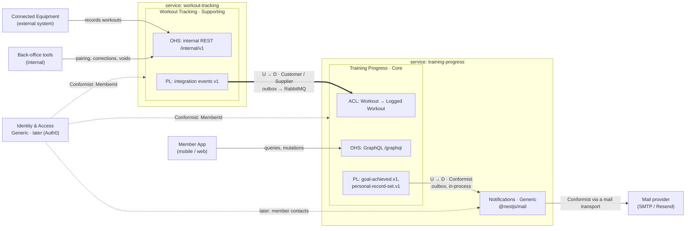

# Fitness platform

Two NestJS microservices, designed with Domain-Driven Design: **Workout Tracking** records what members do on connected equipment, and **Training Progress** turns those workouts into progress: a training log, progress summaries, streaks, personal records and training goals, with email notifications.

## Architecture

A fitness platform made of two NestJS microservices, designed with DDD. The full design is in [docs/architecture.md](docs/architecture.md), and the vocabulary is in [docs/ubiquitous-language.md](docs/ubiquitous-language.md).

| Bounded context | Subdomain | Runs in | API | Data |
|---|---|---|---|---|
| **Training Progress**: training log, progress summaries, streaks, personal records, training goals | Core | `apps/training-progress` | GraphQL, external | PostgreSQL instance 2, Redis cache |
| **Workout Tracking**: equipment, pairing, recording, correcting and voiding workouts | Supporting | `apps/workout-tracking` | REST, internal | PostgreSQL instance 1 |
| **Notifications**: mail about achievements, built on `@nestjs/mail` | Generic | a module in `apps/training-progress` | none | none of its own |
| **Calendar**: training period boundaries, built on `date-fns` | Generic | a value object in Training Progress | none | none |
| **Identity & Access** | Generic | later: an identity provider | | |

The services share no database and never call each other. Aggregates raise domain events, which are written to a transactional outbox (`@nestjs/outbox`) in the same transaction as the change. Inside a service, the outbox delivers them to policies that update other aggregates, one aggregate per transaction. Between contexts, only integration events in a published language travel: over RabbitMQ to the other service, and in-process to Notifications. Every consumer applies each event once, through its inbox. Context, aggregate and layer boundaries are checked at build time by `pnpm check:architecture` (dependency-cruiser; rules in section 11.1 of the proposal).

### Context map



**Legend:** U = upstream, D = downstream, OHS = Open Host Service, PL = Published Language, ACL = Anticorruption Layer. There is no Shared Kernel: `libs/workout-tracking-contracts` holds only Workout Tracking's published language (event payloads and topic names), and `libs/ddd` only technical building blocks, never domain classes.

## Getting started

Prerequisites: Node.js 24, pnpm, Docker with Compose.

```bash
pnpm install
cp apps/workout-tracking/.env.example apps/workout-tracking/.env
cp apps/training-progress/.env.example apps/training-progress/.env

# PostgreSQL x2, Redis, RabbitMQ, and the Liquibase migrations with test records
docker compose up -d --wait
```

Liquibase (`apps/<service>/liquibase`) creates and updates both databases, including the outbox's `nest_outbox` schema, and adds test records: Ada's bike (`BK-0001`, paired with `ada@example.com`), Grace's treadmill (`TM-0001`), an unpaired rower (`RW-0001`), and two active training goals. Leave the test records out with `LIQUIBASE_CONTEXTS=none docker compose up -d --wait`. RabbitMQ's exchange, queue, dead-letter exchange and queue come from `infrastructure/rabbitmq/definitions.json`.

| Service | Port | Main API |
|---|---|---|
| Workout Tracking | 3001 | REST, internal: `http://localhost:3001/internal/v1/...` |
| Training Progress | 3002 | GraphQL: `http://localhost:3002/graphql` (Apollo Sandbox in the browser) |
| RabbitMQ management | 15672 | `fitness` / `fitness` |

```bash
# development, with watch mode (one terminal each)
pnpm start:dev workout-tracking
pnpm start:dev training-progress

# production build
pnpm build
pnpm start:prod:workout-tracking
pnpm start:prod:training-progress
```

Until Identity exists, a member is identified by their email address (not verified). Notifications are written as `.eml` files to `var/mail` (`MAIL_TRANSPORT=file`); set `MAIL_TRANSPORT=smtp` with `SMTP_URL`, or `resend` with `RESEND_API_KEY`, to send them.

### Try it

```bash
# Ada's bike records a 120 km ride...
curl -X POST localhost:3001/internal/v1/equipment/0199c3a2-0000-7000-8000-000000000001/recordings \
  -H 'content-type: application/json' \
  -d '{"recordingId":"ride-1","discipline":"CYCLING","startedAt":"2026-10-05T07:00:00.000Z","durationSeconds":14400,"distanceMeters":120000,"calories":2900}'

# ...which reaches Training Progress through the outbox and RabbitMQ
curl localhost:3002/graphql -H 'content-type: application/json' \
  -d '{"query":"{ member(id: \"ada@example.com\") { trainingLog { edges { node { distanceMeters } } } personalRecords { metric value } trainingGoals { status progress } } }"}'
```

### Postman

`postman/` holds two collections; import them into Postman, or run them with `pnpm dlx newman run <file>`:

- `workout-tracking.postman_collection.json`: the REST API, from registering and pairing equipment to recording, correcting and voiding workouts, with the error cases and the operations routes.
- `training-progress.postman_collection.json`: the GraphQL API: a member's progress, training log, summaries, personal records and training goals, with the mutations and their domain errors.

Run the Workout Tracking collection first: its workouts are what Training Progress shows.

## Tests and checks

```bash
pnpm test                 # unit tests: aggregates (given/when/then), value objects, policies' building blocks
pnpm test:e2e             # each service on in-process PostgreSQL (PGlite) with its Liquibase changesets
pnpm lint                 # oxlint and the architecture check
pnpm check:architecture   # context, aggregate and layer boundaries (dependency-cruiser)
```

`pnpm build` runs the architecture check before compiling.

## Operations

- Health: `GET /health/live` and `GET /health/ready` on both services. Readiness is `down` without the service's PostgreSQL, and `degraded` (still 200) without RabbitMQ or Redis.
- Outbox: `GET /internal/v1/admin/outbox/stats` and `/dead-letters` on Workout Tracking, `/internal/admin/outbox/...` on Training Progress, with the `x-admin-token` header (`ADMIN_TOKEN`). Dead letters can be requeued with `POST .../dead-letters/:id/requeue`.
- RabbitMQ dead letters (invalid integration events, or ones that failed 5 deliveries): queue `training-progress.workout-tracking.dlq`.

## Metrics

### Lambda → ECS + NestJS metrics mapping

| Lambda | ECS + NestJS equivalent | Where to find it |
|---|---|---|
| `Invocations` | `RequestCount` | `AWS/ApplicationELB` |
| `Duration` | `TargetResponseTime` (p50/p95/p99) | `AWS/ApplicationELB` |
| `Errors` | `HTTPCode_Target_5XX_Count` | `AWS/ApplicationELB` |
| `Throttles` | `RejectedConnectionCount`, 503s, CPU saturation | ALB + `AWS/ECS` |
| `ConcurrentExecutions` | `RunningTaskCount`, active requests per task | Container Insights, app metrics |
| `Max Memory Used` | `MemoryUtilization` | `AWS/ECS` (per service) |
| Cold start / `Init Duration` | Time for a task to start and pass health checks, plus Nest bootstrap time | ECS service events, app log |
| `REPORT` log line | Nothing automatic; log each request from a NestJS interceptor | CloudWatch Logs (`awslogs` driver) |
| X-Ray | OpenTelemetry + ADOT collector sidecar → X-Ray | X-Ray / CloudWatch |
| Lambda Insights | Container Insights (per-task CPU, memory, network) | `ECS/ContainerInsights` |
