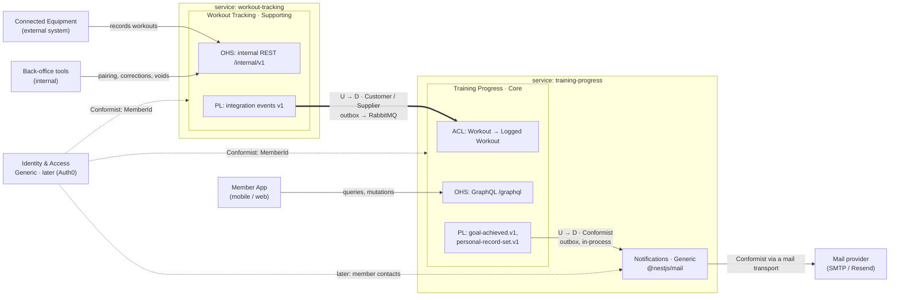
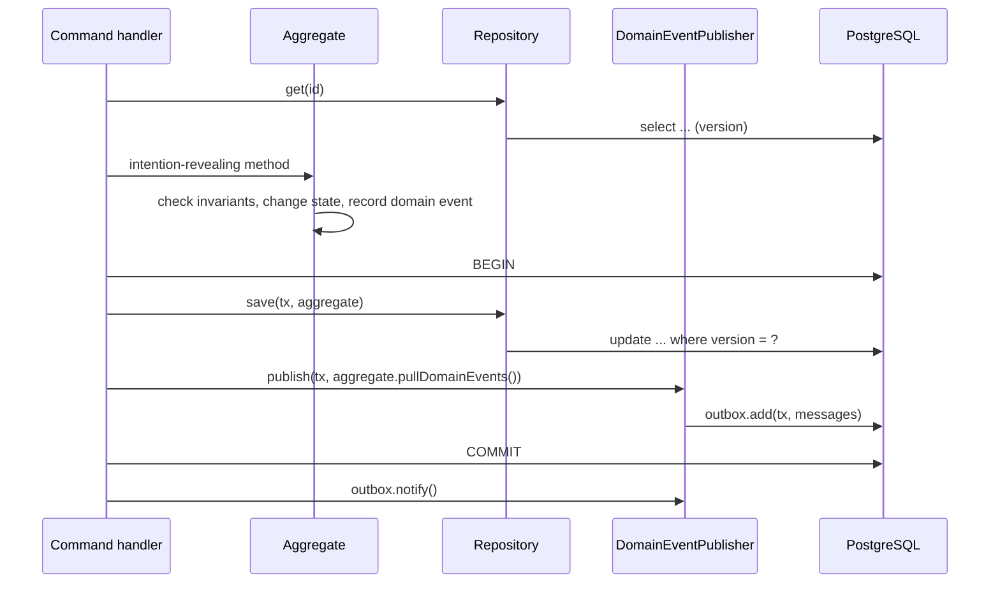
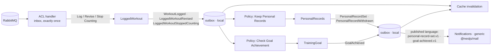

# Architecture proposal: fitness platform

**Status:** proposal, 2026-10-08. Nothing below is implemented yet.

The vocabulary used here is defined in [the ubiquitous language](ubiquitous-language.md). Implementation follows the NestJS docs cached in [`docs/nestjs/`](nestjs/); each section links to the page it's based on.

## 1. Scope

**In scope:** two NestJS microservices in one Nest CLI monorepo; a separate PostgreSQL instance for each; domain events and integration events through the transactional outbox, with RabbitMQ between the services; Redis caching; Terminus health checks; validation on every boundary; DDD, strategic and tactical.

**Out of scope for now, on purpose:** authentication and authorization, SQS/SNS, Docker images, Terraform, and monitoring (metrics, tracing, alerting). Where a design decision depends on one of them, this document says so.

## 2. Strategic design

### 2.1 Subdomains

| Subdomain | Type | Why | Approach |
|---|---|---|---|
| **Training Progress**: training log, progress summaries, streaks, personal records, training goals | **Core** | Turning workouts into visible progress is what keeps members training and subscribed. This is where we compete. | Built in-house, with the richest domain model and most design effort: aggregates, domain events, policies. |
| **Workout Tracking**: equipment, pairing, recording workouts, corrections, voids | **Supporting** | Necessary and specific to us, but members don't choose us because we can store numbers from a bike. | Built in-house but kept simple: two small aggregates with clear invariants, no in-process policies. |
| **Notifications**: telling members about achievements | **Generic** | Every product sends mail; nothing about it is ours. | **Built now from an off-the-shelf library**: `@nestjs/mail` ([`application/mail.md`](nestjs/application/mail.md)). No domain model, only templates and a reaction to Training Progress' published language. |
| **Calendar**: ISO weeks, months, years, period boundaries | **Generic** | A solved problem, and an easy one to get subtly wrong. | **Built now from a library**: `date-fns`, used inside the `TrainingPeriod` value object. No hand-written week arithmetic. |
| **Identity & Access** | **Generic** | A solved problem. | Later: an identity provider (Auth0). Until then `memberId` is passed explicitly, and Notifications gets contact addresses through a port with a development adapter. |
| **Billing & Subscriptions** | **Generic** | A solved problem. | Out of scope. Buy (for example Stripe). |

The effort follows the classification: the core domain gets the full tactical toolset (section 3), the supporting domain a lean version of it, and generic subdomains no domain model at all, only a library behind a port.

### 2.2 Bounded contexts and deployment

| Bounded context | Subdomain | Service | Main API | Database |
|---|---|---|---|---|
| Workout Tracking | Supporting | `apps/workout-tracking` | REST, internal (`/internal/v1/...`) | PostgreSQL instance 1, `workout_tracking` |
| Training Progress | Core | `apps/training-progress` | GraphQL, external (`/graphql`) | PostgreSQL instance 2, `training_progress`; Redis cache |
| Notifications | Generic | Hosted as a module inside `apps/training-progress` | None | None of its own (its outbox inbox lives in instance 2) |

- Each core or supporting bounded context has its own service and database. No service reads another service's database, and the services never call each other synchronously.
- A generic subdomain doesn't need a service of its own. Notifications runs as a module inside `training-progress`, but it is still a separate bounded context: it consumes only Training Progress' **published language** (integration events, delivered in-process), never its domain events, repositories or tables. If it ever needs to serve more contexts, it moves out by switching that transport to RabbitMQ, without changes to Training Progress' model.
- Workout Tracking's REST API is internal: equipment and back-office tools call it from the private network. Because authentication is out of scope, it must not be exposed publicly until authentication exists.

### 2.3 Context map



| Upstream | Downstream | Relationship |
|---|---|---|
| Workout Tracking | Training Progress | **Customer/Supplier.** Workout Tracking offers an **Open Host Service** with a **Published Language**: versioned integration events whose contracts live in `libs/workout-tracking-contracts`. Training Progress states its needs (for example the `revision` field) and protects its model with an **Anticorruption Layer** that also translates the language: a *correction* upstream becomes *revising* the logged workout downstream, a *void* becomes *stopping counting* it. |
| Workout Tracking | Connected Equipment, back-office tools | **Open Host Service**: the internal REST API. Equipment firmware conforms to it. |
| Training Progress | Notifications | **Conformist** to Training Progress' published language (`goal-achieved.v1`, `personal-record-set.v1`). Notifications is generic and has no model worth protecting, so it doesn't translate; Training Progress still maps its domain events to that language, so its model can change without breaking Notifications. |
| Mail provider | Notifications | **Conformist**, isolated behind `@nestjs/mail`'s `MailTransport`: switching SMTP for Resend is configuration. |
| Identity provider (later) | All | **Conformist on identity only**: each context's own `MemberId` value object holds the identity provider's subject id; nothing else of the provider's model is adopted. |
| Identity provider (later) | Notifications | **Anticorruption Layer**: the `MemberContactDirectory` adapter translates the provider's user profile into a *Member Contact*, so the provider's vocabulary ("user") never reaches Notifications. |

**No Shared Kernel**, on purpose. Two libraries are shared, and neither contains domain concepts:
- `libs/workout-tracking-contracts`: Workout Tracking's published language (integration event payloads and topic names). Owned by Workout Tracking.
- `libs/ddd`: technical building blocks (`AggregateRoot`, `DomainEvent`, `DomainError`). Plain TypeScript.

Training Progress' published language lives in its own app (`training-progress/published-language/`), because its only consumer runs in the same process. It moves to a library when Notifications moves out.

Each context defines its own `Discipline`, value objects and rules, even when they look alike.

### 2.4 Event storming summary

The big picture as commands, aggregates, domain events and policies ("whenever X, then Y"). This is the backbone of both models; every row becomes a use case or a policy handler.

**Workout Tracking**

| Actor | Command | Aggregate | Domain event | Then |
|---|---|---|---|---|
| Back-office | Register Equipment | `Equipment` | `EquipmentRegistered` | |
| Back-office | Pair Equipment | `Equipment` | `EquipmentPaired` | |
| Back-office | Unpair Equipment | `Equipment` | `EquipmentUnpaired` | |
| Equipment | Record Workout | `Equipment` (factory) creates `Workout` | `WorkoutRecorded` | Published as integration event `workout-recorded.v1` |
| Back-office | Correct Workout | `Workout` | `WorkoutCorrected` | Published as `workout-corrected.v1` |
| Back-office | Void Workout | `Workout` | `WorkoutVoided` | Published as `workout-voided.v1` |

**Training Progress** (and the generic Notifications)

| Actor or trigger | Command | Aggregate | Domain event | Then (policies) |
|---|---|---|---|---|
| ACL, on `workout-recorded.v1` | Log Workout | `LoggedWorkout` | `WorkoutLogged` | **Keep Personal Records**; **Check Goal Achievement**; invalidate cache |
| ACL, on `workout-corrected.v1` | Revise Logged Workout | `LoggedWorkout` | `LoggedWorkoutRevised` | **Keep Personal Records** (recalculate); **Check Goal Achievement**; invalidate cache |
| ACL, on `workout-voided.v1` | Stop Counting Logged Workout | `LoggedWorkout` | `LoggedWorkoutStoppedCounting` | **Keep Personal Records** (recalculate); invalidate cache |
| Policy: Keep Personal Records | Consider Logged Workout / Recalculate Personal Records | `PersonalRecords` | `PersonalRecordSet`, `PersonalRecordWithdrawn` | `PersonalRecordSet` is published as `personal-record-set.v1` → **Notify Personal Record** (Notifications); invalidate cache |
| Member (GraphQL) | Set Training Goal | `TrainingGoal` | `TrainingGoalSet` | **Check Goal Achievement** (workouts already in the period count) |
| Policy: Check Goal Achievement | Record Goal Progress | `TrainingGoal` | `GoalAchieved` | Published as `goal-achieved.v1` → **Notify Goal Achieved** (Notifications) |
| Member (GraphQL) | Abandon Training Goal | `TrainingGoal` | `GoalAbandoned` | |
| Scheduler, daily | Miss Ended Goals | `TrainingGoal` | `GoalMissed` | |

## 3. Tactical design rules

These apply to both contexts. The supporting context uses fewer of them because it needs fewer, not because the rules differ.

**Aggregates**
- Small aggregates around true invariants: an aggregate holds only what must be consistent **immediately**.
- **One aggregate per transaction.** Anything that spans aggregates is eventually consistent, through a domain event and a policy.
- Aggregates refer to each other by id only (`EquipmentId` on a `Workout`, `LoggedWorkoutId` in a `PersonalRecord`), never by object reference, and never take another aggregate as a method argument. Identifiers from outside the context (`MemberId`) are local value objects too.
- **Strict aggregate isolation, enforced at build time** (section 11.1): each module keeps its ids and value objects in `domain/values/`, and that folder is the only part of its domain another module's domain may import. Aggregate roots, entities, repositories, domain events and domain errors are private to their module. The application layer may still coordinate several aggregates of its context (read one, change another), one aggregate per transaction.
- Concurrent changes are caught by optimistic locking: every aggregate table has a `version` (or `revision`) column, and an update that finds a different version fails with a conflict.
- Ids are generated by the domain (UUIDv7) before the aggregate is saved, so events can carry them.
- Behaviour, not setters: aggregates expose intention-revealing methods named in the ubiquitous language (`workout.void(reason)`, never `workout.status = ...`). No anemic models.
- Scope ids are explicit where ownership is an invariant: `goal.abandon(memberId)` refuses a member who isn't the goal's member.

**Value objects**
- Immutable, self-validating, compared by value: `Distance`, `Duration`, `Calories`, `SerialNumber`, `RecordingId`, `TrainingPeriod`, `GoalTarget`, ids. A value that exists is valid.
- No primitive obsession in the domain: a method takes a `Distance`, not a `number`.

**Domain events**
- Named in the past tense in the ubiquitous language; immutable; carry an `eventId`, `occurredAt`, the aggregate id, and the facts of the change in the local model's terms. Payloads aren't shaped for a particular subscriber; what other contexts need is shaped in the integration event.
- **Raised by aggregates**, which record them as they change; never raised by controllers or repositories.
- **Stored through the outbox in the same transaction as the aggregate** (section 4). An event is never published from memory.
- Domain events are internal to their context. What leaves the context, even to a generic context in the same process, is an **integration event** in the published language, mapped from the domain event, so the internal model can change without breaking consumers.
- Only meaningful business facts become events, not property changes or technical signals. Cache invalidation, for example, listens to existing facts; no event exists just for it.

**Repositories**
- One per aggregate root, with a collection-like interface (`get`, `save`), defined in `domain/` as a port and implemented in `infrastructure/`. No generic repository, and none for entities inside an aggregate.
- They load and save **whole aggregates** and map between rows and domain objects; no ORM types reach the domain.

**Domain services, factories and specifications**
- Domain services only for domain operations that need several domain objects and fit none of them. None is needed so far, and none should be invented: technical work (mapping, serialization, publishing) is never a domain service.
- Creation rules that depend on another aggregate go into a factory method on that aggregate: `equipment.recordWorkout(recording)` creates a `Workout`. This is the only kind of domain-to-domain import of another module's aggregate root, and each one is declared by name in the architecture check (section 11.1).
- The domain decides **what** counts, the application layer fetches **how much**. A training goal knows which workouts count towards it, so it exposes that as a specification value object, `goal.progressCriteria()` (counting, started inside the goal period, of the goal's discipline; with `isMetBy(discipline, startedAt)` for a single logged or revised workout, which always counts). The application layer sums the training log for those criteria with SQL and passes the result to `goal.recordProgress(progress)`. The aggregate never reaches into infrastructure.

**Entities or value objects**
- Entities only where identity and lifecycle matter: the aggregate roots. A personal record, for example, is replaced as a whole when beaten, so it's a value object inside the `PersonalRecords` aggregate.

**Persistence model**
- State-based persistence, not Event Sourcing: nothing here needs to rebuild state by replaying events. Domain events are stored only until they're delivered (outbox), and the audit Workout Tracking needs is a corrections table.

**Application layer**
- Thin use cases: load the aggregate, call one method, save it, stage its events, commit. No business rules.
- Commands and queries go through `@nestjs/cqrs`'s `CommandBus` and `QueryBus` ([`recipes/cqrs.md`](nestjs/recipes/cqrs.md)). Not used from that recipe: its `AggregateRoot` base class (the domain stays framework-free with `libs/ddd`) and its `EventBus` for anything that leaves the transaction, because it publishes from memory (the dual-write problem from the outbox docs).
- **Queries bypass the domain model** (CQRS): read models such as the training log and progress summaries are read with SQL straight into DTOs. Repositories are for changing state only.

**Policies (domain event handlers)**
- One policy reacts to one kind of fact and changes **one aggregate per transaction**.
- Idempotent, in one of two ways (section 4.4): the inbox in the same transaction, or a state guard in the aggregate.

**Anti-patterns to reject in review:** anemic entities with public setters; business rules in controllers, resolvers or DTOs; repositories that return ORM rows; one transaction changing two aggregates; publishing events from memory; reading another context's tables; reusing upstream event classes as the downstream model; CRUD verbs where the language has a word (`update` for *correct*, `delete` for *void*).

## 4. Domain events and the outbox

Based on [`reliability/outbox.md`](nestjs/reliability/outbox.md) (`@nestjs/outbox`) and [`application/mail.md`](nestjs/application/mail.md) (sending mail after a commit).

### 4.1 From aggregate to outbox



- `libs/ddd`'s `AggregateRoot` records events (`record(event)`) and hands them over once (`pullDomainEvents()`).
- `DomainEventPublisher` is an application-layer port; its infrastructure adapter maps each domain event to zero or more outbox messages through a **route table** and calls `outbox.add(tx, ...)` with the domain transaction. The message id is the event's `eventId`, so every consumer deduplicates on the same id.
- A domain event without a route (for example `EquipmentPaired`, which nobody subscribes to yet) isn't written: the outbox retries a topic that has no handler instead of dropping it. When a subscriber appears, adding the route is the only change.

**Route table**

| Domain event | Domain topic (policies in the same context) | Integration topic (published language) |
|---|---|---|
| `WorkoutRecorded`, `WorkoutCorrected`, `WorkoutVoided` | | `workout-tracking.integration.workout-recorded.v1` (`-corrected`, `-voided`) |
| `WorkoutLogged`, `LoggedWorkoutRevised`, `LoggedWorkoutStoppedCounting` | `training-progress.domain.workout-logged.v1` (`logged-workout-revised`, `logged-workout-stopped-counting`) | |
| `PersonalRecordSet` | `training-progress.domain.personal-record-set.v1` | `training-progress.integration.personal-record-set.v1` |
| `PersonalRecordWithdrawn` | `training-progress.domain.personal-record-withdrawn.v1` | |
| `TrainingGoalSet` | `training-progress.domain.training-goal-set.v1` | |
| `GoalAchieved` | | `training-progress.integration.goal-achieved.v1` |
| `EquipmentRegistered`, `EquipmentPaired`, `EquipmentUnpaired`, `GoalMissed`, `GoalAbandoned` | No subscriber yet, not written | |

### 4.2 Topics, transports and keys

| Kind | Topic pattern | Transport (`route`) | Example |
|---|---|---|---|
| Domain event, handled in the same service | `<context>.domain.<event>.v<n>` | `local`: `@OnOutboxMessage()` handlers in this process | `training-progress.domain.workout-logged.v1` |
| Integration event, for other contexts | `<context>.integration.<event>.v<n>` | RabbitMQ (`ClientProxyTransport`) when the consumer is another service; `local` when it runs in the same process (Notifications) | `workout-tracking.integration.workout-recorded.v1`, `training-progress.integration.goal-achieved.v1` |

Domain event payloads are versioned too: during a rolling deploy, a message added by the previous release can be delivered to the new one (outbox production checklist).

**Keys** (messages that share a key are published one at a time, in commit order):
- Integration events from Workout Tracking: key `memberId`, so a correction or void never overtakes the recording it changes.
- `WorkoutLogged`, `LoggedWorkoutRevised`, `LoggedWorkoutStoppedCounting`: key `memberId`, so personal records and goals see a member's workouts in order.
- Training Progress' integration events for Notifications (`personal-record-set.v1`, `goal-achieved.v1`): **no key**. A key is shared across topics, so a mail outage would otherwise hold back that member's progress (the outbox docs make the same point about email).

### 4.3 Domain events inside Training Progress



Every arrow into an aggregate is its own transaction, and every arrow out of one is an outbox message written in that same transaction.

### 4.4 Idempotency of every handler

The outbox and RabbitMQ deliver **at least once**, so every handler must tolerate a repeat.

| Handler | Consumer name | How a repeat is made harmless |
|---|---|---|
| ACL: apply an integration event | `training-progress` | `OutboxInbox.processInTransaction()`: the inbox record commits with the `LoggedWorkout` change. Plus the source revision guard against reordering |
| Keep Personal Records | `personal-records` | `ctx.processInTransaction()` with the `PersonalRecords` transaction. Also naturally idempotent: considering the same workout twice can't beat itself |
| Check Goal Achievement | `goal-achievement` | **State guard**: `recordProgress()` only acts on an `Active` goal, so a repeat finds it `Achieved` and records nothing. Each affected goal is its own transaction, which keeps one aggregate per transaction |
| Notify Personal Record, Notify Goal Achieved | `notifications.*` | Default inbox (skip ids already handled) plus `idempotencyKey: message.id` on the mail, as the mail docs show |
| Cache invalidation | `cache-invalidation` | `inbox: false`: deleting a key twice is harmless |

## 5. Workout Tracking (supporting subdomain, REST)

### 5.1 Domain model

**`Equipment`** (aggregate root): `EquipmentId`, `SerialNumber`, `EquipmentType`, optional `pairedMemberId`, `version`.
- `Equipment.register(serialNumber, type)` → `EquipmentRegistered`. The serial number is unique across the platform (enforced by a unique constraint, reported as a domain error).
- `pair(memberId)` → `EquipmentPaired`. Allowed when unpaired; pairing again with the same member changes nothing; pairing with another member while paired is refused (unpair first).
- `unpair()` → `EquipmentUnpaired`. Allowed only when paired.
- `recordWorkout(recording)`: **factory** for a new `Workout`. The rules for a new workout belong to the equipment: it must be paired, and the discipline must be a supported discipline of its type. The workout is attributed to the paired member at that moment. The equipment itself doesn't change, so the transaction saves only the workout.

**`Workout`** (aggregate root): `WorkoutId`, `EquipmentId`, `RecordingId`, `MemberId`, `Discipline`, `startedAt`, `WorkoutMetrics` (`Duration`, `Distance`, `Calories`), `WorkoutStatus`, `revision`.
- Invariants: duration greater than zero and at most 24 hours; distance and calories zero or more; `startedAt` not in the future (5 minutes of clock skew allowed).
- `correct(metrics, reason)` → `WorkoutCorrected`. Only while `Recorded`; same invariants; a reason is required; `revision + 1`.
- `void(reason)` → `WorkoutVoided`. Only while `Recorded`; a reason is required; final; `revision + 1`.

**Route table:** `WorkoutRecorded`, `WorkoutCorrected` and `WorkoutVoided` map to their integration events (5.4). The equipment events have no route yet. Workout Tracking has no in-process policies: as a supporting domain, it records facts and publishes them.

### 5.2 Internal REST API

URI versioning ([`http/versioning.md`](nestjs/http/versioning.md)) under the global prefix `internal` ([`faq/global-prefix.md`](nestjs/faq/global-prefix.md)). Health routes are excluded from both.

| Method and path | Command or query | Success | Domain errors |
|---|---|---|---|
| `POST /internal/v1/equipment` | Register Equipment | `201` equipment | `409` serial number already registered |
| `GET /internal/v1/equipment/:equipmentId` | Get Equipment | `200` | `404` |
| `PUT /internal/v1/equipment/:equipmentId/pairing` | Pair Equipment | `200` | `404`, `409` paired with another member |
| `DELETE /internal/v1/equipment/:equipmentId/pairing` | Unpair Equipment | `204` | `404`, `409` not paired |
| `POST /internal/v1/equipment/:equipmentId/recordings` | Record Workout | `201` workout, or `200` with the existing workout for a duplicate recording | `404`, `409` not paired, `422` discipline not supported or invalid metrics |
| `GET /internal/v1/workouts/:workoutId` | Get Workout | `200` | `404` |
| `GET /internal/v1/members/:memberId/workouts?limit=&cursor=` | A member's workouts, newest first, keyset pagination | `200` | |
| `POST /internal/v1/workouts/:workoutId/corrections` | Correct Workout | `200` workout | `404`, `409` voided, `422` invalid metrics |
| `POST /internal/v1/workouts/:workoutId/void` | Void Workout | `200` workout | `404`, `409` already voided |

Malformed input is a `400` from `ValidationPipe` on every route. Responses are representations (response DTOs) built by the application layer, never serialized aggregates.

- **Commands in the path, not CRUD verbs:** a correction and a void are business actions with a required reason, a new revision and an event. `DELETE` would contradict the rule that a voided workout is kept.
- **Duplicate recordings:** `(equipment_id, recording_id)` is unique. If two identical recordings race, the second insert hits the constraint, and the use case returns the existing workout with `200`: no second workout, no second event.

### 5.3 Persistence (PostgreSQL instance 1)

| Table | Columns | Constraints and indexes |
|---|---|---|
| `equipment` | `id`, `serial_number`, `type`, `paired_member_id` (nullable), `paired_at`, `registered_at`, `version` | unique `serial_number` |
| `workouts` | `id`, `equipment_id`, `recording_id`, `member_id`, `discipline`, `started_at`, `duration_seconds`, `distance_meters`, `calories`, `status`, `revision`, `void_reason`, `voided_at`, `recorded_at` | unique `(equipment_id, recording_id)`; index `(member_id, started_at desc, id desc)` |
| `workout_corrections` | `workout_id`, `revision`, previous and new metrics, `reason`, `corrected_at` | primary key `(workout_id, revision)`. Audit trail |
| `nest_outbox.*` | Owned and migrated by `PostgresOutboxStore` | |

### 5.4 Published language (`libs/workout-tracking-contracts`)

| Domain event | Integration event topic |
|---|---|
| `WorkoutRecorded` | `workout-tracking.integration.workout-recorded.v1` |
| `WorkoutCorrected` | `workout-tracking.integration.workout-corrected.v1` |
| `WorkoutVoided` | `workout-tracking.integration.workout-voided.v1` |

All three carry the full workout snapshot (event-carried state transfer), so the consumer never has to call back:

```json
{
  "id": "0199c3a2-…",
  "topic": "workout-tracking.integration.workout-recorded.v1",
  "key": "4f1c…",
  "createdAt": "2026-10-08T09:30:12.000Z",
  "payload": {
    "workoutId": "0199c3a2-…",
    "memberId": "4f1c…",
    "equipmentType": "BIKE",
    "discipline": "CYCLING",
    "startedAt": "2026-10-08T08:30:00.000Z",
    "durationSeconds": 2700,
    "distanceMeters": 18200,
    "calories": 530,
    "status": "RECORDED",
    "revision": 1
  }
}
```

The envelope is `@nestjs/outbox`'s `OutboxEnvelope`; `id` is the domain event's `eventId`, on which the inbox deduplicates. A breaking change means a new version (`.v2`), published next to `.v1` until every consumer has moved.

## 6. Training Progress (core subdomain, GraphQL)

### 6.1 Domain model

**`LoggedWorkout`** (aggregate root): this context's own model of a workout, created and changed only through the anticorruption layer. Its commands take local types (`LoggedWorkoutId`, `MemberId`, this context's `Discipline`, `Distance`, `Duration`, `Calories`, `SourceRevision`), never the contract classes.
- `LoggedWorkout.log(...)` → `WorkoutLogged`.
- `revise(metrics, sourceRevision)` → `LoggedWorkoutRevised`; `stopCounting(sourceRevision)` → `LoggedWorkoutStoppedCounting`.
- **Source revision guard:** a change whose source revision isn't newer than the stored one is ignored and raises nothing. This protects against reordering, on top of the inbox protecting against redelivery.

**`PersonalRecords`** (aggregate root, one per member and discipline): holds a `PersonalRecord` **value object** per record metric (value, logged workout, set at), replaced as a whole when it changes.
- **Why this boundary:** the three records of a discipline have no invariant between them, so strictly each could be its own aggregate. They're kept together because every change considers or recalculates all three from the same logged workout, only that member's events ever write them (no contention), and one transaction per event keeps the policy exactly-once with the inbox. Splitting them would triple the transactions without protecting anything more.
- `consider(loggedWorkoutId, startedAt, metrics)` → `PersonalRecordSet` for each record metric the workout beats. It takes the logged workout's value objects (from `training-log/domain/values/`), never the `LoggedWorkout` aggregate; the policy builds them from the `WorkoutLogged` payload.
- `recalculate(recordCandidates)` → `PersonalRecordSet` where a record candidate now beats the record, `PersonalRecordWithdrawn` where the logged workout holding a record no longer supports it (revised lower, or stopped counting) and the record falls back to the next best, or disappears. A personal record has to be true, so unlike an achievement it can be withdrawn. The record candidates are read from the training log by the application layer.

**`TrainingGoal`** (aggregate root):
- `TrainingGoal.set(...)` → `TrainingGoalSet`. Goal target greater than zero; the goal period ends after it starts, and in the future.
- `progressCriteria()`: the specification of which logged workouts count towards it (counting, started inside the goal period, of the goal's discipline), as a `GoalProgressCriteria` value object with `isMetBy(discipline, startedAt)`. The grace period doesn't widen the criteria; it only delays `miss()`.
- `recordProgress(progress)` → `GoalAchieved` when the goal is `Active` and progress has reached the target. Achievement is final.
- `miss(today)` → `GoalMissed` when the goal is still `Active` after the goal period plus the **grace period** (one day, so late-arriving recordings still count).
- `abandon(memberId)` → `GoalAbandoned`. Only while `Active`, and only by the goal's member.
- Goal progress is never stored: the application layer sums the training log for `progressCriteria()` and passes the result in.

**Read models** (queries, not aggregates): `TrainingLog`, `ProgressSummary`, `Streak`. Read with SQL, cached where useful (section 8).

**`TrainingPeriod`** (value object) in the `calendar` module: week, month or year boundaries, built on `date-fns` (the generic Calendar subdomain). Used by summaries, streaks and goals.

### 6.2 Policies

Policies are application-layer handlers: they load one aggregate, call one method, save it and stage its events, in one transaction.

| Policy | Listens to | Does |
|---|---|---|
| Keep Personal Records | `WorkoutLogged` | `consider()` on the member's `PersonalRecords` for that discipline |
| | `LoggedWorkoutRevised`, `LoggedWorkoutStoppedCounting` | Reads the record candidates from the training log, then `recalculate()` on the member's `PersonalRecords` for that discipline |
| Check Goal Achievement | `WorkoutLogged`, `LoggedWorkoutRevised` | Loads the member's `Active` goals; for each goal whose `progressCriteria().isMetBy(discipline, startedAt)` is true, in its own transaction: sum the training log for `progressCriteria()`, then `recordProgress()`. The decision which goals are affected stays in the domain |
| | `TrainingGoalSet` | The same for the new goal, because workouts already in its period count |
| Miss Ended Goals (scheduled, daily, [`application/task-scheduling.md`](nestjs/application/task-scheduling.md)) | | `miss()` on each `Active` goal past its grace period, each in its own transaction |

### 6.3 Notifications (generic subdomain, `@nestjs/mail`)

- A separate bounded context, hosted as a module in `training-progress`. It handles Training Progress' published language with two `@OnOutboxMessage()` handlers: **Notify Personal Record** (`training-progress.integration.personal-record-set.v1`) and **Notify Goal Achieved** (`training-progress.integration.goal-achieved.v1`). It never imports Training Progress' domain.
- It follows the mail docs' "Send after the order commits" section: `idempotencyKey: message.id`, `signal: ctx.signal`, `retry: false` (the outbox retries), and permanent mail errors become `NonRetryableMessageError`.
- No domain model, on purpose: mail classes render templates from the event payload.
- Recipients come from a `MemberContactDirectory` port. Until Identity exists, its adapter derives a development address from configuration; later it reads the identity provider.
- Transport: `FileMailTransport` in development (writes `.eml` files, no mail server needed), SMTP or Resend in production, chosen from the environment.

### 6.4 GraphQL API (external)

Code first, Apollo driver ([`graphql/quick-start.md`](nestjs/graphql/quick-start.md)). Until authentication exists, the member is chosen with `member(id:)`; later this becomes `me`, with the id taken from the access token.

```graphql
scalar DateTime

enum Discipline { CYCLING RUNNING WALKING ROWING }
enum PeriodKind { WEEK MONTH YEAR }
enum RecordMetric { LONGEST_DISTANCE LONGEST_DURATION MOST_CALORIES }
enum GoalMetric { DISTANCE DURATION CALORIES WORKOUT_COUNT }
enum GoalStatus { ACTIVE ACHIEVED MISSED ABANDONED }

type Query {
  member(id: ID!): Member!
}

type Mutation {
  setTrainingGoal(input: SetTrainingGoalInput!): TrainingGoal!
  abandonTrainingGoal(input: AbandonTrainingGoalInput!): TrainingGoal!
}

type Member {
  id: ID!
  "Counting workouts only, newest first."
  trainingLog(first: Int = 20, after: String, discipline: Discipline): LoggedWorkoutConnection!
  "The training period that contains `date` (default: today, UTC)."
  progressSummary(period: PeriodKind!, date: DateTime, discipline: Discipline): ProgressSummary!
  streak: Int!
  personalRecords(discipline: Discipline): [PersonalRecord!]!
  trainingGoals(status: GoalStatus): [TrainingGoal!]!
}

type LoggedWorkout {
  id: ID!
  discipline: Discipline!
  startedAt: DateTime!
  durationSeconds: Int!
  distanceMeters: Int!
  calories: Int!
}

type LoggedWorkoutConnection { edges: [LoggedWorkoutEdge!]! pageInfo: PageInfo! }
type LoggedWorkoutEdge { cursor: String! node: LoggedWorkout! }
type PageInfo { hasNextPage: Boolean! endCursor: String }

type ProgressSummary {
  period: PeriodKind!
  periodStart: DateTime!
  periodEnd: DateTime!
  discipline: Discipline
  workoutCount: Int!
  totalDurationSeconds: Int!
  totalDistanceMeters: Int!
  totalCalories: Int!
}

type PersonalRecord {
  discipline: Discipline!
  metric: RecordMetric!
  value: Int!
  setAt: DateTime!
  loggedWorkout: LoggedWorkout!
}

type TrainingGoal {
  id: ID!
  metric: GoalMetric!
  target: Int!
  discipline: Discipline
  startsOn: DateTime!
  endsOn: DateTime!
  status: GoalStatus!
  progress: Int!
  achievedAt: DateTime
}

input SetTrainingGoalInput {
  memberId: ID!
  metric: GoalMetric!
  target: Int!
  discipline: Discipline
  startsOn: DateTime!
  endsOn: DateTime!
}

input AbandonTrainingGoalInput { memberId: ID! trainingGoalId: ID! }
```

These types are client representations built from read models and command results, not the aggregates: `TrainingGoal.progress`, for example, exists only here. Mutations go through `CommandBus`, queries through `QueryBus`. Domain errors become GraphQL errors with an `extensions.code` (`NOT_FOUND`, `CONFLICT`, `INVARIANT_VIOLATION`). `TrainingGoal.progress` runs one query per goal; a member has few goals, so that's acceptable. Add a DataLoader if lists grow.

### 6.5 Persistence (PostgreSQL instance 2)

| Table | Columns | Constraints and indexes |
|---|---|---|
| `logged_workouts` | `id` (= upstream `WorkoutId`), `member_id`, `discipline`, `started_at`, `duration_seconds`, `distance_meters`, `calories`, `counts`, `source_revision` (also the optimistic-lock check), `logged_at` | index `(member_id, started_at desc, id desc) where counts` |
| `personal_records` | `member_id`, `discipline`, and per record metric its value, logged workout and set-at time (`longest_distance_meters`, `longest_distance_logged_workout_id`, `longest_distance_set_at`, ...), `version` | primary key `(member_id, discipline)`: one row per `PersonalRecords` aggregate |
| `training_goals` | `id`, `member_id`, `metric`, `target`, `discipline` (nullable), `starts_on`, `ends_on`, `status`, `set_at`, `achieved_at`, `missed_at`, `abandoned_at`, `version` | index `(member_id, status)` |
| `nest_outbox.*` | Domain event messages, dead letters and inboxes, owned and migrated by `PostgresOutboxStore` | |

## 7. Integration between the services: RabbitMQ

Based on [`microservices/rabbitmq.md`](nestjs/microservices/rabbitmq.md) and [`faq/hybrid-application.md`](nestjs/faq/hybrid-application.md).

### 7.1 Producer: Workout Tracking

- `OutboxModule.forRootAsync()` with `PostgresOutboxStore` (`fromDrizzle(db)`) and a `ClientProxyTransport` over a RabbitMQ `ClientsModule` client. `route` sends `*.integration.*` topics to RabbitMQ.
- The relay runs in every instance; leases and `SKIP LOCKED` keep instances from publishing the same message in parallel.
- `retry`: the package default of 20 attempts (about 30–60 minutes), so an ordinary broker outage doesn't dead-letter events. Dead letters are inspected and requeued with `OutboxDeadLetters` through an internal admin route.
- **Broker acknowledgement:** the outbox docs warn that only a broker that confirms receipt ("RabbitMQ with publisher confirms") makes "published" mean "stored by the broker". First check whether Nest's RMQ `ClientProxy` waits for confirms. If not, write a small custom `OutboxTransport` that publishes on an `amqp-connection-manager` confirm channel. Messages are `persistent`; exchanges and queues are durable.

### 7.2 Topology

| Object | Settings |
|---|---|
| Exchange `workout-tracking.integration` | topic, durable. Owned by Workout Tracking (the published language) |
| Queue `training-progress.workout-tracking` | quorum, durable, bound to `workout-tracking.integration.#`; `x-single-active-consumer: true`; `x-delivery-limit: 5`; dead-letters to `training-progress.dlx` |
| Queue `training-progress.workout-tracking.dlq` | bound to `training-progress.dlx`; inspected and replayed by hand |

The exchange lets future consumers bind their own queues without changes to Workout Tracking (the RMQ transport's `exchange`, `exchangeType` and `wildcards` options).

### 7.3 Consumer: Training Progress' anticorruption layer

- A hybrid application: GraphQL over HTTP plus an RMQ listener added with `connectMicroservice(..., { inheritAppConfig: true })`. `app.listen()` comes before `startAllMicroservices()`, so no message is handled before every module has initialized.
- `noAck: false`: a message is acked only after its transaction commits.
- For each message, the ACL:
  1. validates the payload against the contract class;
  2. **translates** it into this context's language: `workout-recorded.v1` → *Log Workout*, `workout-corrected.v1` → *Revise Logged Workout*, `workout-voided.v1` → *Stop Counting Logged Workout*;
  3. dispatches the command, whose handler runs in one transaction with `OutboxInbox.processInTransaction(tx, 'training-progress', envelope.id, ...)`: inbox record, `LoggedWorkout` change and its domain events commit together;
  4. acks.
- **Failures:** an invalid payload is nacked without requeue and goes to the DLQ. Any other error is nacked with requeue, and RabbitMQ dead-letters it after `x-delivery-limit` deliveries.
- **Ordering:** the single active consumer keeps the queue order across instances (the others are hot standbys), and inside the process each key's messages are handled one at a time, as in the outbox docs' analytics controller. The source revision guard is the safety net.
- Training Progress' own outbox (relay **enabled**, `local` transport only) carries its domain events to its policies, and its published language to Notifications. A daily job prunes inboxes with `inbox.prune('30d')`.

### 7.4 Delivery guarantees

| Situation | Outcome |
|---|---|
| The workout transaction rolls back | No event exists, in either service |
| RabbitMQ is down | Recording still works; integration events wait in Workout Tracking's outbox |
| A relay publishes, then crashes before marking the message published | Published twice; inboxes drop the duplicate |
| Training Progress crashes before acking | RabbitMQ redelivers; the inbox drops it if the transaction had committed |
| A policy fails (for example a lock conflict) | Its outbox message is retried with backoff; policies that already succeeded are skipped by their inbox |
| The mail provider is down | Notifications retry for minutes; progress is not held back, because those events have no key |
| A message keeps failing | Dead-lettered: in RabbitMQ after 5 deliveries, in the outbox after its retries |

At-least-once delivery everywhere; exactly-once effects on each service's own database.

## 8. Caching (Redis)

Based on [`data/caching.md`](nestjs/data/caching.md): `@nestjs/cache-manager` with `@keyv/redis`, Training Progress only.

- **Redis only, no in-memory tier:** with several instances, an in-memory tier can't be invalidated from a handler running on another instance.
- **Cache-aside in the query handlers through `CACHE_MANAGER`.** The docs warn that `CacheInterceptor` doesn't work with GraphQL, because interceptors run once per field resolver.
- **Invalidation is a domain event handler** (`cache-invalidation`, `inbox: false`), so it runs only after the change committed, and is retried if Redis is briefly unavailable.
- **Cache failures never fail a request:** on a Redis error, read from PostgreSQL, log a warning, and the health check reports `degraded`.

| Key | Holds | TTL | Deleted on |
|---|---|---|---|
| `progress-summary:{memberId}:{periodKind}:{periodStart}:{discipline or all}` | `ProgressSummary` | 10 min | Logged workout events: the week, month and year that contain the workout's `startedAt`, for `all` and its discipline (6 keys) |
| `personal-records:{memberId}` | All the member's personal records | 10 min | `PersonalRecordSet`, `PersonalRecordWithdrawn` |
| `streak:{memberId}` | `Streak` | Until the end of the UTC day | Logged workout events |

The training log isn't cached: it's paginated, and the `(member_id, started_at desc, id desc)` index serves it. Training goals aren't cached either: they're few, and members change them themselves.

## 9. Validation

| Boundary | What's checked | How |
|---|---|---|
| Configuration | Required env vars and their formats; the app doesn't start without them | `@nestjs/config` with a validation schema ([`application/configuration.md`](nestjs/application/configuration.md)) |
| REST input | Shape, types, formats, unknown fields | Global `ValidationPipe({ whitelist: true, forbidNonWhitelisted: true, transform: true })` with `class-validator` DTOs ([`application/validation.md`](nestjs/application/validation.md)) |
| GraphQL input | The same, on `@InputType()` classes | The same global `ValidationPipe` |
| Incoming integration events | Payload against the contract class | In the ACL; invalid → DLQ |
| Domain | Business rules (invariants) | Value objects and aggregates throw `DomainError` subclasses. A REST exception filter maps them to `404`/`409`/`422`; GraphQL maps them to error codes |

DTOs check the **shape** of input; aggregates and value objects check **business rules**. A rule such as "the discipline must be supported by the equipment type" lives only in the domain, never in a DTO.

## 10. Health checks (Terminus)

Based on [`reliability/terminus.md`](nestjs/reliability/terminus.md). Every service exposes:

- `GET /health/live`: no dependency checks. If the process answers, it's alive. A database outage must not make the orchestrator restart every instance.
- `GET /health/ready`: dependencies, each with `withTimeout()`.

| Service | `down` (stop sending traffic) | `degraded` (keep serving, visible in the response) |
|---|---|---|
| Workout Tracking | Its PostgreSQL | RabbitMQ: the outbox keeps the events, so recording still works |
| Training Progress | Its PostgreSQL | Redis (reads fall back to PostgreSQL); RabbitMQ (queries still work, and consumption resumes when it's back) |

- PostgreSQL: a custom indicator with `HealthIndicatorService.attempt()` running `select 1`; Terminus has no Drizzle indicator.
- Redis: a custom indicator that returns `degraded()` when a cache round trip fails.
- RabbitMQ: `MicroserviceHealthIndicator.pingCheck()` with `Transport.RMQ`, reported as `degraded` (a custom `attempt()` indicator if the built-in one doesn't support RMQ).
- `TerminusModule.forRoot({ gracefulShutdownTimeoutMs })` and `app.enableShutdownHooks()`: on `SIGTERM`, readiness turns `503` before the app stops, and the outbox relay drains instead of leaving messages leased.

## 11. Code structure

Nest CLI monorepo ([`cli/workspaces.md`](nestjs/cli/workspaces.md)). Inside each app: **bounded context first**, then one module per aggregate or use-case area, then layers. Technical plumbing lives in `platform/`, which never holds domain concepts.

```
apps/
  workout-tracking/src/
    workout-tracking/                  bounded context (supporting)
      equipment/
        domain/                        equipment.ts (aggregate root), equipment.repository.ts (port), events/, errors/,
                                       values/ (equipment-id.ts, serial-number.ts, equipment-type.ts, member-id.ts)
        application/                   commands/ (register, pair, unpair), queries/
        infrastructure/                drizzle-equipment.repository.ts
        interface/http/                equipment.controller.ts, dto/
      workouts/
        domain/                        workout.ts (aggregate root), workout.repository.ts (port), events/, errors/,
                                       values/ (workout-id.ts, workout-metrics.ts, recording-id.ts, discipline.ts)
        application/                   commands/ (record, correct, void), queries/
        infrastructure/                drizzle-workout.repository.ts
        interface/http/                workouts.controller.ts, recordings.controller.ts, dto/
      published-language/              domain event → integration event mappers (contracts in libs/)
    platform/                          database, outbox setup + DomainEventPublisher + route table,
                                       domain-exception filter, health
  training-progress/src/
    training-progress/                 bounded context (core)
      training-log/                    domain/ (logged-workout.ts, events/, values/: logged-workout-id.ts, discipline.ts,
                                       workout-metrics.ts, source-revision.ts), application/, infrastructure/, interface/graphql/
      personal-records/                domain/ (personal-records.ts, values/: personal-record.ts, record-candidate.ts),
                                       application/ (keep-personal-records.policy.ts), ...
      training-goals/                  domain/ (training-goal.ts, values/: goal-progress-criteria.ts, goal-target.ts, goal-period.ts),
                                       application/ (check-goal-achievement.policy.ts, miss-ended-goals.job.ts), ...
      progress-summary/                application/queries/, interface/graphql/
      calendar/                        domain/values/training-period.ts on date-fns (generic subdomain, used as a library)
      members/                         domain/values/member-id.ts; interface/graphql/member.resolver.ts (the Member root type
                                       and its field resolvers)
      workout-tracking-acl/            RMQ handlers, contract validation, translation into this context's commands
      published-language/              topics and payloads for Notifications, domain event → integration event mappers
    notifications/                     bounded context (generic): mail classes, templates, handlers,
                                       member-contact-directory (port + development adapter)
    platform/                          database, outbox setup + DomainEventPublisher + route table, cache
                                       (incl. the invalidation handler), GraphQL error mapping, health
libs/
  ddd/                                 AggregateRoot, DomainEvent, DomainError (technical, no domain concepts)
  workout-tracking-contracts/          Workout Tracking's published language: topics and payload classes
```

Layer rules (enforced by the architecture check, section 11.1):
- `domain/` imports nothing from NestJS, Drizzle, `@nestjs/outbox` or other layers. Pure libraries for generic subdomains (`date-fns`) and `libs/ddd` are allowed. Aggregates are unit-tested without Nest.
- `application/` holds command and query handlers, policies, and ports (`DomainEventPublisher`, read ports such as the training log totals). Repository ports belong to `domain/`. The application layer opens transactions.
- `infrastructure/` implements the ports with Drizzle and the outbox, and maps rows to aggregates.
- `interface/` (controllers, resolvers, message handlers) validates input, dispatches a command or query, and maps the result.

### 11.1 Architecture check (build-time enforcement)

Context, aggregate and layer boundaries are enforced in code, not only in diagrams. `pnpm check:architecture` runs [dependency-cruiser](https://github.com/sverweij/dependency-cruiser) with `.dependency-cruiser.cjs` over `apps/` and `libs/`. It runs in `pnpm lint`, before `nest build`, and in CI, and any violation fails it. The config is one generic rule per boundary: it matches back-references from the source path (`$1`, `$2`), so a new module is covered without editing the config. **Strict by default:** any domain-to-domain import between modules that isn't listed below fails. A rule is never weakened to let an import through; the design is fixed instead.

| Rule | Forbids | Why |
|---|---|---|
| `no-import-from-another-service` | Any import from `apps/A/` into `apps/B/` | Each core or supporting context is its own service |
| `context-sees-other-contexts-only-through-published-language` | Inside one app, a context folder importing another context folder, except its `published-language/`. `platform/` and the composition root (`app.module.ts`) may import every context | Notifications sees only Training Progress' published language |
| `contracts-only-in-published-language-or-acl` | Importing `libs/workout-tracking-contracts` anywhere except Workout Tracking's `published-language/` and Training Progress' `workout-tracking-acl/` | Contract classes never reach a domain model |
| `libs-only-through-their-entry-point` | Deep imports such as `@app/ddd/aggregate-root.js`; only `@app/<lib>` (its `src/index.ts`) | Libraries have a public API. The Nest library schematic also adds an `@app/<lib>/*` alias, which this rule neutralizes |
| `libs-import-no-app-and-no-other-lib` | `libs/*` importing `apps/*` or another lib | No domain classes in `libs/` |
| `domain-depends-only-on-domain-libs-ddd-and-pure-libraries` | `domain/` importing anything except `domain/` folders (as limited below), `libs/ddd`, and an allow-list of pure libraries (`date-fns`) | Domain is framework-free: no NestJS, Drizzle, `@nestjs/outbox`, contracts, `application/`, `infrastructure/`, `interface/` or `platform/`. An allow-list, so a new package is rejected until it's added on purpose |
| `application-imports-no-infrastructure-or-interface` | `application/` importing `infrastructure/` or `interface/` | Dependencies point inward |
| `infrastructure-imports-no-interface` | `infrastructure/` importing `interface/` | Dependencies point inward |
| `domain-sees-other-modules-only-through-values` | A module's `domain/` importing another module's `domain/` outside `domain/values/` | Strict aggregate isolation: roots, entities, repositories, events and errors stay private; other aggregates are referenced by id |
| Declared factory exceptions | | `equipment/domain` may import `workouts/domain/workout.ts`, because `equipment.recordWorkout()` creates a `Workout`. Each exception is listed with its reason in the config and in this table, and nothing else is exempt |
| `values-import-only-values-and-errors` | `domain/values/` importing anything in `apps/` except other `values/` and `errors/` | Value objects can't leak a root to the modules that import them |
| `no-circular`, `not-to-unresolvable` | Import cycles; imports that don't resolve | Standard hygiene |

What isn't restricted, on purpose: `application/` and `interface/` may import other modules of the same context (a use case may read one aggregate to change another; a policy handles another module's domain events; the `members` resolver composes queries). One aggregate per transaction is checked in review and in tests, not by the import graph. `interface/` may import `domain/values/` to build commands (the ACL builds `LoggedWorkoutId`, `Discipline` and so on).

**Not adopted, on purpose:** a package per bounded context (pnpm workspace packages with `exports`) and TypeScript project references. Here the context boundary is already a service boundary (one Nest app per core or supporting context), and Nest CLI monorepo mode, which this project uses, composes `apps/` and `libs/` through `tsconfig` `paths` and builds each app with its own builder. oxlint's `no-restricted-imports` was considered and rejected: it matches import strings instead of resolved files, and when two `overrides` match a file, the later one replaces the earlier one's rule options, so a context rule and a layer rule can't both apply to the same file (checked with oxlint 1.87).

## 12. Technology choices

| Concern | Choice | Why |
|---|---|---|
| ORM | Drizzle through `@nestjs/drizzle` ([`data/drizzle.md`](nestjs/data/drizzle.md)) | The outbox tutorial's primary setup (`fromDrizzle`); the schema lives in plain TypeScript, which keeps persistence out of the domain classes. Cost: a small custom Terminus indicator |
| Domain events, integration events, inboxes | `@nestjs/outbox` with `PostgresOutboxStore` | Official package: transactional writes, local handlers, retries, dead letters, per-key ordering, inboxes |
| Commands and queries | `@nestjs/cqrs` (`CommandBus`, `QueryBus` only) | Official recipe; one handler per use case |
| GraphQL | `@nestjs/graphql` with `@nestjs/apollo`, code first | Official integration |
| Messaging | `@nestjs/microservices` RMQ transport | Requested instead of SQS/SNS. Swapping the broker later means changing one `OutboxTransport` |
| Notifications (generic) | `@nestjs/mail` | Official package with an outbox integration; file transport for development |
| Calendar (generic) | `date-fns` | ISO weeks and period boundaries without hand-written date arithmetic |
| Cache | `@nestjs/cache-manager` with `@keyv/redis` | Official recipe |
| Health | `@nestjs/terminus` | Official recipe |
| Validation | `class-validator`, `class-transformer` | Official recipe |
| Configuration | `@nestjs/config` | Official recipe |
| Scheduled jobs | `@nestjs/schedule` | Missing ended goals; pruning inboxes |
| Architecture check | `dependency-cruiser`, run with pnpm | The Nest docs have no recipe for import boundaries. It checks the resolved import graph (including `.js` → `.ts` under `nodenext` and the `@app/*` aliases), and its rules compose, which oxlint's overrides don't (section 11.1) |
| Tests | Vitest (already in the template) | Aggregate tests as given/when/then on domain events; policy and ACL tests; e2e tests against real PostgreSQL, as in the outbox docs' Testing section |

## 13. Implementation plan

Every building block is generated with the Nest CLI (see `CLAUDE.md`). Each milestone ends with passing tests and its own commit.

1. **Workspace.** `nest generate app workout-tracking`, `nest generate app training-progress`, `nest generate library ddd`, `nest generate library workout-tracking-contracts`. Remove the template app (and its `@nestjs/observe` setup, since monitoring is out of scope), point `nest-cli.json`'s default project at `workout-tracking`, add `@nestjs/config` with validation to both apps. Write `libs/ddd`. Add the architecture check (`pnpm add -D dependency-cruiser`, `.dependency-cruiser.cjs` with the rules of section 11.1, a `check:architecture` script that runs in `lint` and before `build`). Prove each rule with a forbidden import that fails, then remove it.
2. **Workout Tracking: domain model.** `Equipment` and `Workout` aggregates and value objects, generated with `nest generate class ... --project workout-tracking`. Tests: every invariant and every domain event, given/when/then.
3. **Workout Tracking: application, persistence and REST.** Drizzle schema and repositories, `@nestjs/cqrs` handlers, controllers (`nest generate module|controller ... --project workout-tracking`), the domain exception filter, the global `ValidationPipe`, URI versioning. E2E tests, including duplicate recordings and optimistic-lock conflicts.
4. **Workout Tracking: outbox and published language.** `@nestjs/outbox`, `DomainEventPublisher` with the route table, the RabbitMQ transport with publisher confirms, the contracts, the dead-letter admin routes. Tests: a failed transaction publishes nothing; a duplicate recording publishes nothing new.
5. **Training Progress: training log.** Hybrid app, the ACL with the inbox, the `LoggedWorkout` aggregate, its domain events, GraphQL `member` and `trainingLog`. Tests: the ACL's translation of each integration event; redelivered and out-of-order integration events change nothing.
6. **Training Progress: personal records, progress summary, streak, Redis.** The `PersonalRecords` aggregate and its policy, the read models, cache-aside, invalidation through domain events. Tests: each policy is idempotent; Redis down still answers.
7. **Training Progress: training goals.** The `TrainingGoal` aggregate and its progress criteria, mutations, the Check Goal Achievement policy, the daily jobs.
8. **Notifications (generic).** Training Progress' published language for it, `@nestjs/mail` with `FileMailTransport`, the two handlers, `MemberContactDirectory` with its development adapter.
9. **Health checks in both apps** (`nest generate module health`, `nest generate controller health`, custom indicators), graceful shutdown, and an updated Postman collection: the Workout Tracking REST API plus Training Progress GraphQL requests, replacing the template's `GET /`.

## 14. Assumptions and open questions

| # | Topic | Assumption until decided |
|---|---|---|
| 1 | Running PostgreSQL ×2, Redis and RabbitMQ locally | Dockerization is out of scope, so they run outside this repo. A `docker-compose.yml` for **infrastructure only** would make setup one command. Your call |
| 2 | Time zones | Training periods, active days and streaks use UTC. Real members expect their own time zone; that needs a member time zone, which needs Identity |
| 3 | Achievements vs records | Achievements are final; personal records are recalculated and can go down |
| 4 | Goal grace period | One day after the goal period ends, so late recordings still count |
| 5 | Pairing | Pairing equipment that's paired with another member is refused; it must be unpaired first |
| 6 | Member contacts | Notifications uses a development adapter for addresses until Identity exists |
| 7 | Publisher confirms | Verified against Nest's RMQ client in milestone 4; a custom `OutboxTransport` if needed |
| 8 | Template leftovers | The template's `@nestjs/observe` instrumentation, `@nestjs/mau` deploy script and `GET /` controller are removed in milestone 1 |
