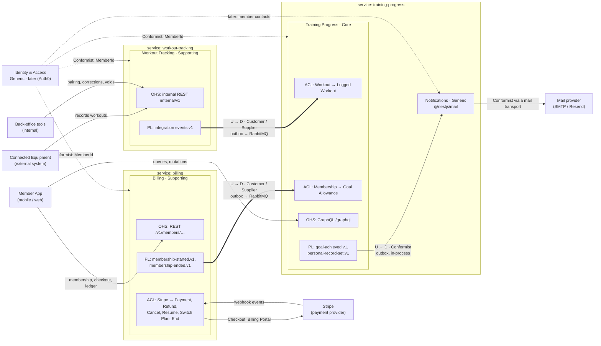
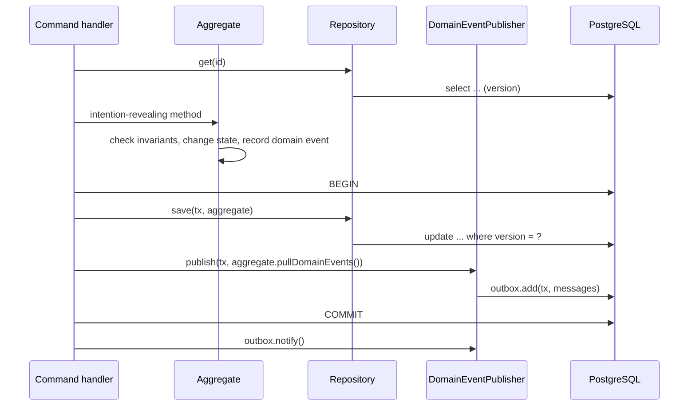
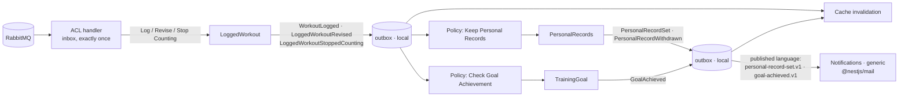

# Architecture proposal: fitness platform

## Architecture

A fitness platform made of three NestJS microservices, designed with DDD. The full design is in [docs/architecture.md](docs/architecture.md), and the vocabulary is in [docs/ubiquitous-language.md](docs/ubiquitous-language.md).

| Bounded context | Subdomain | Runs in | API | Data |
|---|---|---|---|---|
| **Training Progress**: training log, progress summaries, streaks, personal records, training goals | Core | `apps/training-progress` | GraphQL, external | PostgreSQL instance 2, Valkey cache |
| **Workout Tracking**: equipment, pairing, recording, correcting and voiding workouts | Supporting | `apps/workout-tracking` | REST, internal | PostgreSQL instance 1 |
| **Billing**: memberships, the ledger of payments and refunds, over Stripe | Supporting | `apps/billing` | REST, external; Stripe's webhook | PostgreSQL instance 3 |
| **Notifications**: mail about achievements, built on `@nestjs/mail` | Generic | a module in `apps/training-progress` | none | none of its own |
| **Calendar**: training period boundaries, built on `date-fns` | Generic | a value object in Training Progress | none | none |
| **Identity & Access** | Generic | later: an identity provider | | |
| **Payments** | Generic | bought: Stripe, behind Billing's anticorruption layer | | |

The services share no database and never call each other. Aggregates raise domain events, which are written to a transactional outbox (`@nestjs/outbox`) in the same transaction as the change. Inside a service, the outbox delivers them to policies that update other aggregates, one aggregate per transaction. Between contexts, only integration events in a published language travel: over RabbitMQ to the other service, and in-process to Notifications. Every consumer applies each event once, through its inbox. Context, aggregate and layer boundaries are checked at build time by `pnpm check:architecture` (dependency-cruiser; rules in section 11.1 of the proposal).

### Context map



**Legend:** U = upstream, D = downstream, OHS = Open Host Service, PL = Published Language, ACL = Anticorruption Layer. There is no Shared Kernel: `libs/workout-tracking-contracts` and `libs/billing-contracts` hold only their context's published language (event payloads and topic names), and `libs/ddd` only technical building blocks, never domain classes.


**Status:** implemented, 2026-10-09 (proposed 2026-10-08). Where the implementation settled an open point, this document says so.

The vocabulary used here is defined in [the ubiquitous language](ubiquitous-language.md). Implementation follows the NestJS docs cached in [`docs/nestjs/`](nestjs/); each section links to the page it's based on.

## 1. Scope

**In scope:** three NestJS microservices in one Nest CLI monorepo; a separate PostgreSQL instance for each; domain events and integration events through the transactional outbox, with RabbitMQ between the services; Valkey caching; Terminus health checks; validation on every boundary; DDD, strategic and tactical. Infrastructure for development (the three PostgreSQL instances, Valkey, RabbitMQ, and the Stripe CLI) runs in Docker Compose, and Liquibase, also run from Compose, creates and updates both schemas.

**Out of scope for now, on purpose:** authentication and authorization, SQS/SNS, Docker images of the services, Terraform, and monitoring (metrics, tracing, alerting). Where a design decision depends on one of them, this document says so.

## 2. Strategic design

### 2.1 Subdomains

| Subdomain | Type | Why | Approach |
|---|---|---|---|
| **Training Progress**: training log, progress summaries, streaks, personal records, training goals | **Core** | Turning workouts into visible progress is what keeps members training and subscribed. This is where we compete. | Built in-house, with the richest domain model and most design effort: aggregates, domain events, policies. |
| **Workout Tracking**: equipment, pairing, recording workouts, corrections, voids | **Supporting** | Necessary and specific to us, but members don't choose us because we can store numbers from a bike. | Built in-house but kept simple: two small aggregates with clear invariants, no in-process policies. |
| **Notifications**: telling members about achievements | **Generic** | Every product sends mail; nothing about it is ours. | **Built now from an off-the-shelf library**: `@nestjs/mail` ([`application/mail.md`](nestjs/application/mail.md)). No domain model, only templates and a reaction to Training Progress' published language. |
| **Calendar**: ISO weeks, months, years, period boundaries | **Generic** | A solved problem, and an easy one to get subtly wrong. | **Built now from a library**: `date-fns`, used inside the `TrainingPeriod` value object. No hand-written week arithmetic. |
| **Identity & Access** | **Generic** | A solved problem. | Later: an identity provider (Auth0). Until then `memberId` is passed explicitly and is the member's email address (not verified), and Notifications gets contact addresses through a port with a development adapter. |
| **Billing**: memberships, the ledger of payments and refunds | **Supporting** | Ours: what a membership gives and what members paid, in our own records and language. Was generic until [ADR 2](adr/0002-billing-supporting-subdomain-with-stripe.md). | Built in-house but kept simple (section 18): two small aggregates, money as `decimal.js`, one policy. Collecting the money is **generic and bought**: Stripe, behind an anticorruption layer. |

The effort follows the classification: the core domain gets the full tactical toolset (section 3), the supporting domain a lean version of it, and generic subdomains no domain model at all, only a library behind a port.

### 2.2 Bounded contexts and deployment

| Bounded context | Subdomain | Service | Main API | Database |
|---|---|---|---|---|
| Workout Tracking | Supporting | `apps/workout-tracking` | REST, internal (`/internal/v1/...`) | PostgreSQL instance 1, `workout_tracking` |
| Training Progress | Core | `apps/training-progress` | GraphQL, external (`/graphql`) | PostgreSQL instance 2, `training_progress`; Valkey cache |
| Billing | Supporting | `apps/billing` | REST, external (`/v1/members/...`); Stripe's webhook (`/stripe/events`) | PostgreSQL instance 3, `billing` |
| Notifications | Generic | Hosted as a module inside `apps/training-progress` | None | None of its own (its outbox inbox lives in instance 2) |

- Each core or supporting bounded context has its own service and database. No service reads another service's database, and the services never call each other synchronously.
- A generic subdomain doesn't need a service of its own. Notifications runs as a module inside `training-progress`, but it is still a separate bounded context: it consumes only Training Progress' **published language** (integration events, delivered in-process), never its domain events, repositories or tables. If it ever needs to serve more contexts, it moves out by switching that transport to RabbitMQ, without changes to Training Progress' model.
- Workout Tracking's REST API is internal: equipment and back-office tools call it from the private network. Because authentication is out of scope, it must not be exposed publicly until authentication exists.

### 2.3 Context map


| Upstream | Downstream | Relationship |
|---|---|---|
| Workout Tracking | Training Progress | **Customer/Supplier.** Workout Tracking offers an **Open Host Service** with a **Published Language**: versioned integration events whose contracts live in `libs/workout-tracking-contracts`. Training Progress states its needs (for example the `revision` field) and protects its model with an **Anticorruption Layer** that also translates the language: a *correction* upstream becomes *revising* the logged workout downstream, a *void* becomes *stopping counting* it. |
| Workout Tracking | Connected Equipment, back-office tools | **Open Host Service**: the internal REST API. Equipment firmware conforms to it. |
| Billing | Training Progress | **Customer/Supplier.** Billing's published language (`libs/billing-contracts`: `membership-started.v1`, `membership-ended.v1`, the whole membership without amounts) over RabbitMQ. Training Progress' **Anticorruption Layer** (`billing-acl/`) translates it into its own concept: a membership that started *extends* the member's **goal allowance**, one that ended *restricts* it; the membership's revision becomes the source revision. |
| Stripe | Billing | **Anticorruption Layer** (`stripe-acl/`), both ways: Stripe's webhook events become Billing's commands, and Billing's `PaymentProvider` port opens Stripe's hosted Checkout and Billing Portal. Stripe's customers, subscriptions, invoices and charges never leave it (ADR 2). |
| Training Progress | Notifications | **Conformist** to Training Progress' published language (`goal-achieved.v1`, `personal-record-set.v1`). Notifications is generic and has no model worth protecting, so it doesn't translate; Training Progress still maps its domain events to that language, so its model can change without breaking Notifications. |
| Mail provider | Notifications | **Conformist**, isolated behind `@nestjs/mail`'s `MailTransport`: switching SMTP for Resend is configuration. |
| Identity provider (later) | All | **Conformist on identity only**: each context's own `MemberId` value object holds the identity provider's subject id; nothing else of the provider's model is adopted. |
| Identity provider (later) | Notifications | **Anticorruption Layer**: the `MemberContactDirectory` adapter translates the provider's user profile into a *Member Contact*, so the provider's vocabulary ("user") never reaches Notifications. |

**No Shared Kernel**, on purpose. Three libraries are shared, and none contains domain concepts:
- `libs/workout-tracking-contracts`: Workout Tracking's published language (integration event payloads, topic names and the CloudEvents `source`). Owned by Workout Tracking.
- `libs/billing-contracts`: Billing's published language, likewise. Owned by Billing.
- `libs/ddd`: technical building blocks (`AggregateRoot`, `DomainEvent`, `DomainError`). Plain TypeScript.

Training Progress' published language lives in its own app (`training-progress/published-language/`), because its only consumer runs in the same process. It moves to a library when Notifications moves out.

Each context defines its own `Discipline`, value objects and rules, even when they look alike.

### 2.4 Event storming summary

The big picture as commands, aggregates, domain events and policies ("whenever X, then Y"). This is the backbone of both models; every row becomes a use case or a policy handler.

**Workout Tracking**

| Actor | Command | Aggregate | Domain event | Then |
|---|---|---|---|---|
| Back-office | Register Equipment | `Equipment` | `EquipmentRegistered` | |
| Back-office | Pair Equipment | `Equipment` | `EquipmentPaired` | |
| Back-office | Unpair Equipment | `Equipment` | `EquipmentUnpaired` | |
| Equipment | Record Workout | `Equipment` (factory) creates `Workout` | `WorkoutRecorded` | Published as integration event `workout-recorded.v1` |
| Back-office | Correct Workout | `Workout` | `WorkoutCorrected` | Published as `workout-corrected.v1` |
| Back-office | Void Workout | `Workout` | `WorkoutVoided` | Published as `workout-voided.v1` |

**Training Progress** (and the generic Notifications)

| Actor or trigger | Command | Aggregate | Domain event | Then (policies) |
|---|---|---|---|---|
| ACL, on `workout-recorded.v1` | Log Workout | `LoggedWorkout` | `WorkoutLogged` | **Keep Personal Records**; **Check Goal Achievement**; invalidate cache |
| ACL, on `workout-corrected.v1` | Revise Logged Workout | `LoggedWorkout` | `LoggedWorkoutRevised` | **Keep Personal Records** (recalculate); **Check Goal Achievement**; invalidate cache |
| ACL, on `workout-voided.v1` | Stop Counting Logged Workout | `LoggedWorkout` | `LoggedWorkoutStoppedCounting` | **Keep Personal Records** (recalculate); invalidate cache |
| Policy: Keep Personal Records | Consider Logged Workout / Recalculate Personal Records | `PersonalRecords` | `PersonalRecordSet`, `PersonalRecordWithdrawn` | `PersonalRecordSet` is published as `personal-record-set.v1` → **Notify Personal Record** (Notifications); invalidate cache |
| Member (GraphQL) | Set Training Goal | `TrainingGoal` | `TrainingGoalSet` | **Check Goal Achievement** (workouts already in the period count) |
| Policy: Check Goal Achievement | Record Goal Progress | `TrainingGoal` | `GoalAchieved` | Published as `goal-achieved.v1` → **Notify Goal Achieved** (Notifications) |
| Member (GraphQL) | Abandon Training Goal | `TrainingGoal` | `GoalAbandoned` | |
| Schedule trigger (Kubernetes CronJob, daily) | Miss Ended Goals | `TrainingGoal` | `GoalMissed` | |
| ACL, on `membership-started.v1` / `membership-ended.v1` | Extend / Restrict Goal Allowance | `GoalAllowance` | `GoalAllowanceExtended`, `GoalAllowanceRestricted` | Set a Goal checks it |

**Billing** (section 18)

| Actor or trigger | Command | Aggregate | Domain event | Then |
|---|---|---|---|---|
| Member (REST) | Start Checkout, Open Billing Portal | none: Stripe's hosted pages | | The member pays or changes things there; Stripe reports it |
| ACL, on Stripe's `invoice.paid` | Record Payment | `LedgerEntry` | `PaymentRecorded` | **Apply Payment** |
| Policy: Apply Payment | Start / Renew Membership | `Membership` | `MembershipStarted`, `MembershipRenewed` | `MembershipStarted` published as `membership-started.v1` |
| ACL, on `customer.subscription.updated` | Cancel, Resume, Switch Plan | `Membership` | `MembershipCancelled`, `MembershipResumed`, `MembershipPlanSwitched` | |
| ACL, on `customer.subscription.deleted` | End Membership | `Membership` | `MembershipEnded` | Published as `membership-ended.v1` |
| ACL, on `charge.refunded` | Record Refund | `LedgerEntry` | `RefundRecorded` | |

## 3. Tactical design rules

These apply to both contexts. The supporting context uses fewer of them because it needs fewer, not because the rules differ.

**Aggregates**
- Small aggregates around true invariants: an aggregate holds only what must be consistent **immediately**.
- **One aggregate per transaction.** Anything that spans aggregates is eventually consistent, through a domain event and a policy.
- Aggregates refer to each other by id only (`EquipmentId` on a `Workout`, `LoggedWorkoutId` in a `PersonalRecord`), never by object reference, and never take another aggregate as a method argument. Identifiers from outside the context (`MemberId`) are local value objects too.
- **Strict aggregate isolation, enforced at build time** (section 11.1): each module keeps its ids and value objects in `domain/values/`, and that folder is the only part of its domain another module's domain may import. Aggregate roots, entities, repositories, domain events and domain errors are private to their module. The application layer may still coordinate several aggregates of its context (read one, change another), one aggregate per transaction.
- Concurrent changes are caught by optimistic locking: every aggregate table has a `version` (or `revision`) column, and an update that finds a different version fails with a conflict.
- Ids are generated by the domain (UUIDv7) before the aggregate is saved, so events can carry them.
- Behaviour, not setters: aggregates expose intention-revealing methods named in the ubiquitous language (`workout.void(reason)`, never `workout.status = ...`). No anemic models.
- Scope ids are explicit where ownership is an invariant: `goal.abandon(memberId)` refuses a member who isn't the goal's member.

**Value objects**
- Immutable, self-validating, compared by value: `Distance`, `Duration`, `Calories`, `SerialNumber`, `RecordingId`, `TrainingPeriod`, `GoalTarget`, ids. A value that exists is valid.
- No primitive obsession in the domain: a method takes a `Distance`, not a `number`.

**Domain events**
- Named in the past tense in the ubiquitous language; immutable; carry an `eventId`, `occurredAt`, the aggregate id, and the facts of the change in the local model's terms. Payloads aren't shaped for a particular subscriber; what other contexts need is shaped in the integration event.
- **Raised by aggregates**, which record them as they change; never raised by controllers or repositories.
- **Stored through the outbox in the same transaction as the aggregate** (section 4). An event is never published from memory.
- Domain events are internal to their context. What leaves the context, even to a generic context in the same process, is an **integration event** in the published language, mapped from the domain event, so the internal model can change without breaking consumers.
- Only meaningful business facts become events, not property changes or technical signals. Cache invalidation, for example, listens to existing facts; no event exists just for it.

**Repositories**
- One per aggregate root, with a collection-like interface (`get`, `save`), defined in `domain/` as a port and implemented in `infrastructure/`. No generic repository, and none for entities inside an aggregate.
- They load and save **whole aggregates** and map between rows and domain objects; no ORM types reach the domain.

**Domain services, factories and specifications**
- Domain services only for domain operations that need several domain objects and fit none of them. None is needed so far, and none should be invented: technical work (mapping, serialization, publishing) is never a domain service.
- Creation rules that depend on another aggregate go into a factory method on that aggregate: `equipment.recordWorkout(recording)` creates a `Workout`. This is the only kind of domain-to-domain import of another module's aggregate root, and each one is declared by name in the architecture check (section 11.1).
- The domain decides **what** counts, the application layer fetches **how much**. A training goal knows which workouts count towards it, so it exposes that as a specification value object, `goal.progressCriteria()` (counting, started inside the goal period, of the goal's discipline; with `isMetBy(discipline, startedAt)` for a single logged or revised workout, which always counts). The application layer sums the training log for those criteria with SQL and passes the result to `goal.recordProgress(progress)`. The aggregate never reaches into infrastructure.

**Entities or value objects**
- Entities only where identity and lifecycle matter: the aggregate roots. A personal record, for example, is replaced as a whole when beaten, so it's a value object inside the `PersonalRecords` aggregate.

**Persistence model**
- State-based persistence, not Event Sourcing: nothing here needs to rebuild state by replaying events. Domain events are stored only until they're delivered (outbox), and the audit Workout Tracking needs is a corrections table.

**Application layer**
- Thin use cases: load the aggregate, call one method, save it, stage its events, commit. No business rules.
- Commands and queries go through `@nestjs/cqrs`'s `CommandBus` and `QueryBus` ([`recipes/cqrs.md`](nestjs/recipes/cqrs.md)). Not used from that recipe: its `AggregateRoot` base class (the domain stays framework-free with `libs/ddd`) and its `EventBus` for anything that leaves the transaction, because it publishes from memory (the dual-write problem from the outbox docs).
- **Queries bypass the domain model** (CQRS): read models such as the training log and progress summaries are read with SQL straight into DTOs. Repositories are for changing state only.

**Policies (domain event handlers)**
- One policy reacts to one kind of fact and changes **one aggregate per transaction**.
- Idempotent, in one of two ways (section 4.4): the inbox in the same transaction, or a state guard in the aggregate.

**Anti-patterns to reject in review:** anemic entities with public setters; business rules in controllers, resolvers or DTOs; repositories that return ORM rows; one transaction changing two aggregates; publishing events from memory; reading another context's tables; reusing upstream event classes as the downstream model; CRUD verbs where the language has a word (`update` for *correct*, `delete` for *void*).

## 4. Domain events and the outbox

Based on [`reliability/outbox.md`](nestjs/reliability/outbox.md) (`@nestjs/outbox`) and [`application/mail.md`](nestjs/application/mail.md) (sending mail after a commit).

### 4.1 From aggregate to outbox



- `libs/ddd`'s `AggregateRoot` records events (`record(event)`) and hands them over once (`pullDomainEvents()`).
- `DomainEventPublisher` is an application-layer port; its infrastructure adapter maps each domain event to zero or more outbox messages through a **route table** and calls `outbox.add(tx, ...)` with the domain transaction. The message id is the event's `eventId`, so every consumer deduplicates on the same id.
- A domain event without a route (for example `EquipmentPaired`, which nobody subscribes to yet) isn't written: the outbox retries a topic that has no handler instead of dropping it. When a subscriber appears, adding the route is the only change.

**Route table**

| Domain event | Domain topic (policies in the same context) | Integration topic (published language) |
|---|---|---|
| `WorkoutRecorded`, `WorkoutCorrected`, `WorkoutVoided` | | `workout-tracking.integration.workout-recorded.v1` (`-corrected`, `-voided`) |
| `WorkoutLogged`, `LoggedWorkoutRevised`, `LoggedWorkoutStoppedCounting` | `training-progress.domain.workout-logged.v1` (`logged-workout-revised`, `logged-workout-stopped-counting`) | |
| `PersonalRecordSet` | `training-progress.domain.personal-record-set.v1` | `training-progress.integration.personal-record-set.v1` |
| `PersonalRecordWithdrawn` | `training-progress.domain.personal-record-withdrawn.v1` | |
| `TrainingGoalSet` | `training-progress.domain.training-goal-set.v1` | |
| `GoalAchieved` | | `training-progress.integration.goal-achieved.v1` |
| `PaymentRecorded` (Billing) | `billing.domain.payment-recorded.v1` | |
| `MembershipStarted`, `MembershipEnded` (Billing) | | `billing.integration.membership-started.v1` (`-ended`) |
| `EquipmentRegistered`, `EquipmentPaired`, `EquipmentUnpaired`, `GoalMissed`, `GoalAbandoned`, `GoalAllowanceExtended`, `GoalAllowanceRestricted`; Billing's `MembershipRenewed`, `MembershipPlanSwitched`, `MembershipCancelled`, `MembershipResumed`, `RefundRecorded` | No subscriber yet, not written | |

### 4.2 Topics, transports and keys

| Kind | Topic pattern | Transport (`route`) | Example |
|---|---|---|---|
| Domain event, handled in the same service | `<context>.domain.<event>.v<n>` | `local`: `@OnOutboxMessage()` handlers in this process | `training-progress.domain.workout-logged.v1` |
| Integration event, for other contexts | `<context>.integration.<event>.v<n>` | RabbitMQ (`ClientProxyTransport`), as a CloudEvent whose `type` is the topic, when the consumer is another service; `local` when it runs in the same process (Notifications) | `workout-tracking.integration.workout-recorded.v1`, `training-progress.integration.goal-achieved.v1` |

Domain event payloads are versioned too: during a rolling deploy, a message added by the previous release can be delivered to the new one (outbox production checklist).

**Keys** (messages that share a key are published one at a time, in commit order):
- Integration events from Workout Tracking: key `memberId`, so a correction or void never overtakes the recording it changes.
- `WorkoutLogged`, `LoggedWorkoutRevised`, `LoggedWorkoutStoppedCounting`: key `memberId`, so personal records and goals see a member's workouts in order.
- Training Progress' integration events for Notifications (`personal-record-set.v1`, `goal-achieved.v1`): **no key**. A key is shared across topics, so a mail outage would otherwise hold back that member's progress (the outbox docs make the same point about email).

### 4.3 Domain events inside Training Progress



Every arrow into an aggregate is its own transaction, and every arrow out of one is an outbox message written in that same transaction.

### 4.4 Idempotency of every handler

The outbox and RabbitMQ deliver **at least once**, so every handler must tolerate a repeat.

| Handler | Consumer name | How a repeat is made harmless |
|---|---|---|
| ACL: apply an integration event | `training-progress` | `OutboxInbox.processInTransaction()`: the inbox record commits with the `LoggedWorkout` change. Plus the source revision guard against reordering |
| Keep Personal Records | `personal-records` | `ctx.processInTransaction()` with the `PersonalRecords` transaction. Also naturally idempotent: considering the same workout twice can't beat itself |
| Check Goal Achievement | `goal-achievement` | **State guard**: `recordProgress()` only acts on an `Active` goal, so a repeat finds it `Achieved` and records nothing. Each affected goal is its own transaction, which keeps one aggregate per transaction |
| Notify Personal Record, Notify Goal Achieved | `notifications.*` | Default inbox (skip ids already handled) plus `idempotencyKey: message.id` on the mail, as the mail docs show |
| Cache invalidation | `cache-invalidation` | `inbox: false`: deleting a key twice is harmless |
| Billing ACL in Training Progress: Extend / Restrict Goal Allowance | `training-progress.billing` | `processInTransaction()` with the `GoalAllowance`, plus the source revision guard (the membership's revision) against reordering |
| Billing: Stripe's events (Record Payment, Record Refund, Cancel, Resume, Switch Plan, End) | `webhooks:stripe` | The command's `runOnce()` with the change; `@nestjs/webhooks`' own deduplication is off, so the record commits with the change. Plus state guards in `Membership`, and the unique `(kind, provider_reference)` of ledger entries for an event Stripe sends twice under two ids |
| Billing: Apply Payment | `apply-payment` | `runOnce()` with the `Membership`; and `renew()` changes nothing for a period already paid |

## 5. Workout Tracking (supporting subdomain, REST)

### 5.1 Domain model

**`Equipment`** (aggregate root): `EquipmentId`, `SerialNumber`, `EquipmentType`, optional `pairedMemberId`, `version`.
- `Equipment.register(serialNumber, type)` → `EquipmentRegistered`. The serial number is unique across the platform (enforced by a unique constraint, reported as a domain error).
- `pair(memberId)` → `EquipmentPaired`. Allowed when unpaired; pairing again with the same member changes nothing; pairing with another member while paired is refused (unpair first).
- `unpair()` → `EquipmentUnpaired`. Allowed only when paired.
- `recordWorkout(recording)`: **factory** for a new `Workout`. The rules for a new workout belong to the equipment: it must be paired, and the discipline must be a supported discipline of its type. The workout is attributed to the paired member at that moment. The equipment itself doesn't change, so the transaction saves only the workout.

**`Workout`** (aggregate root): `WorkoutId`, `EquipmentId`, `RecordingId`, `MemberId`, `Discipline`, `startedAt`, `WorkoutMetrics` (`Duration`, `Distance`, `Calories`), `WorkoutStatus`, `revision`.
- Invariants: duration greater than zero and at most 24 hours; distance and calories zero or more; `startedAt` not in the future (5 minutes of clock skew allowed).
- `correct(metrics, reason)` → `WorkoutCorrected`. Only while `Recorded`; same invariants; a reason is required; `revision + 1`.
- `void(reason)` → `WorkoutVoided`. Only while `Recorded`; a reason is required; final; `revision + 1`.

**Route table:** `WorkoutRecorded`, `WorkoutCorrected` and `WorkoutVoided` map to their integration events (5.4). The equipment events have no route yet. Workout Tracking has no in-process policies: as a supporting domain, it records facts and publishes them.

### 5.2 Internal REST API

URI versioning ([`http/versioning.md`](nestjs/http/versioning.md)) under the global prefix `internal` ([`faq/global-prefix.md`](nestjs/faq/global-prefix.md)). Health routes are excluded from both.

| Method and path | Command or query | Success | Domain errors |
|---|---|---|---|
| `POST /internal/v1/equipment` | Register Equipment | `201` equipment | `409` serial number already registered |
| `GET /internal/v1/equipment/:equipmentId` | Get Equipment | `200` | `404` |
| `PUT /internal/v1/equipment/:equipmentId/pairing` | Pair Equipment | `200` | `404`, `409` paired with another member |
| `DELETE /internal/v1/equipment/:equipmentId/pairing` | Unpair Equipment | `204` | `404`, `409` not paired |
| `POST /internal/v1/equipment/:equipmentId/recordings` | Record Workout | `201` workout, or `200` with the existing workout for a duplicate recording | `404`, `409` not paired, `422` discipline not supported or invalid metrics |
| `GET /internal/v1/workouts/:workoutId` | Get Workout | `200` | `404` |
| `GET /internal/v1/members/:memberId/workouts?limit=&cursor=` | A member's workouts, newest first, keyset pagination | `200` | |
| `POST /internal/v1/workouts/:workoutId/corrections` | Correct Workout | `200` workout | `404`, `409` voided, `422` invalid metrics |
| `POST /internal/v1/workouts/:workoutId/void` | Void Workout | `200` workout | `404`, `409` already voided |

Malformed input is a `400` from `ValidationPipe` on every route. Responses are representations (response DTOs) built by the application layer, never serialized aggregates.

- **Commands in the path, not CRUD verbs:** a correction and a void are business actions with a required reason, a new revision and an event. `DELETE` would contradict the rule that a voided workout is kept.
- **Duplicate recordings:** `(equipment_id, recording_id)` is unique. If two identical recordings race, the second insert hits the constraint, and the use case returns the existing workout with `200`: no second workout, no second event.

### 5.3 Persistence (PostgreSQL instance 1)

| Table | Columns | Constraints and indexes |
|---|---|---|
| `equipment` | `id`, `serial_number`, `type`, `paired_member_id` (nullable), `paired_at`, `registered_at`, `version` | unique `serial_number` |
| `workouts` | `id`, `equipment_id`, `equipment_type` (kept for the published snapshot), `recording_id`, `member_id`, `discipline`, `started_at`, `duration_seconds`, `distance_meters`, `calories`, `status`, `revision`, `void_reason`, `voided_at`, `recorded_at` | unique `(equipment_id, recording_id)`; index `(member_id, started_at desc, id desc)` |
| `workout_corrections` | `workout_id`, `revision`, previous and new metrics, `reason`, `corrected_at` | primary key `(workout_id, revision)`. Audit trail |
| `nest_outbox.*` | The outbox store's tables, created by Liquibase from `nest-outbox sql` (changeset 0002); the store runs with `migrate: false` | |

**Migrations:** Liquibase, formatted SQL changelogs in `apps/workout-tracking/liquibase` (master `changelog.yaml`), run in Liquibase's Docker image by `scripts/database/liquibase.sh workout-tracking update` (the same folder has the tag and rollback scripts). Test records are changesets with `context:test-data`. The Drizzle schema in `platform/database/schema.ts` mirrors the changesets and is only used to build queries. The e2e tests apply the same changesets to a real PostgreSQL in Docker (Testcontainers, the same image as compose.yaml): formatted SQL is plain SQL with comments.

### 5.4 Published language (`libs/workout-tracking-contracts`)

| Domain event | Integration event topic |
|---|---|
| `WorkoutRecorded` | `workout-tracking.integration.workout-recorded.v1` |
| `WorkoutCorrected` | `workout-tracking.integration.workout-corrected.v1` |
| `WorkoutVoided` | `workout-tracking.integration.workout-voided.v1` |

All three carry the full workout snapshot (event-carried state transfer), so the consumer never has to call back. Each one travels as a [CloudEvent](https://cloudevents.io) 1.0 in the JSON event format, in the structured content mode of the CloudEvents AMQP binding: the message's content type is `application/cloudevents+json; charset=utf-8`, and its body is the whole event:

```json
{
  "specversion": "1.0",
  "id": "0199c3a2-…",
  "source": "/workout-tracking",
  "type": "workout-tracking.integration.workout-recorded.v1",
  "subject": "0199c3a2-…",
  "time": "2026-10-08T09:30:12.000Z",
  "datacontenttype": "application/json",
  "partitionkey": "ada@example.com",
  "data": {
    "workoutId": "0199c3a2-…",
    "memberId": "ada@example.com",
    "equipmentType": "BIKE",
    "discipline": "CYCLING",
    "startedAt": "2026-10-08T08:30:00.000Z",
    "durationSeconds": 2700,
    "distanceMeters": 18200,
    "calories": 530,
    "status": "RECORDED",
    "revision": 1
  }
}
```

| Attribute | Value |
|---|---|
| `id` | The outbox message id, which is the domain event's `eventId`: the same on every redelivery, so the inbox deduplicates on it |
| `source` | `/workout-tracking` (`WORKOUT_TRACKING_SOURCE`) |
| `type` | The topic, also the routing key. Kept as it is rather than renamed to a reverse-DNS name (a SHOULD in the specification), so the routing keys and bindings didn't change |
| `subject` | The workout id |
| `time` | When the change was recorded: the outbox message's creation, in the same transaction |
| `partitionkey` | The member id ([Partitioning extension](https://github.com/cloudevents/spec/blob/main/cloudevents/extensions/partitioning.md)): the outbox key, which keeps a member's events in order |
| `datacontenttype`, `data` | `application/json`, the `WorkoutSnapshotV1` |

The AMQP properties repeat the id (`message_id`) and the type (`type`), for tools that read only those. A breaking change means a new version (`.v2`), published next to `.v1` until every consumer has moved.

## 6. Training Progress (core subdomain, GraphQL)

### 6.1 Domain model

**`LoggedWorkout`** (aggregate root): this context's own model of a workout, created and changed only through the anticorruption layer. Its commands take local types (`LoggedWorkoutId`, `MemberId`, this context's `Discipline`, `Distance`, `Duration`, `Calories`, `SourceRevision`), never the contract classes.
- `LoggedWorkout.log(...)` → `WorkoutLogged`.
- `revise(metrics, sourceRevision)` → `LoggedWorkoutRevised`; `stopCounting(sourceRevision)` → `LoggedWorkoutStoppedCounting`.
- **Source revision guard:** a change whose source revision isn't newer than the stored one is ignored and raises nothing. This protects against reordering, on top of the inbox protecting against redelivery.
- `LoggedWorkout.logStoppedCounting(...)`: a void that overtook its recording logs the workout as not counting, raising nothing (the member's training log doesn't change). Without it, the late recording would log it as counting.

**`PersonalRecords`** (aggregate root, one per member and discipline): holds a `PersonalRecord` **value object** per record metric (value, logged workout, set at), replaced as a whole when it changes.
- **Why this boundary:** the three records of a discipline have no invariant between them, so strictly each could be its own aggregate. They're kept together because every change considers or recalculates all three from the same logged workout, only that member's events ever write them (no contention), and one transaction per event keeps the policy exactly-once with the inbox. Splitting them would triple the transactions without protecting anything more.
- `consider(loggedWorkoutId, startedAt, metrics)` → `PersonalRecordSet` for each record metric the workout beats. It takes the logged workout's value objects (from `training-log/domain/values/`), never the `LoggedWorkout` aggregate; the policy builds them from the `WorkoutLogged` payload.
- `recalculate(recordCandidates)` → `PersonalRecordSet` where a record candidate now beats the record, `PersonalRecordWithdrawn` where the logged workout holding a record no longer supports it (revised lower, or stopped counting) and the record falls back to the next best, or disappears. A personal record has to be true, so unlike an achievement it can be withdrawn. The record candidates are read from the training log by the application layer.

**`TrainingGoal`** (aggregate root):
- `TrainingGoal.set(...)` → `TrainingGoalSet`. Goal target greater than zero; the goal period ends after it starts, and in the future.
- `progressCriteria()`: the specification of which logged workouts count towards it (counting, started inside the goal period, of the goal's discipline), as a `GoalProgressCriteria` value object with `isMetBy(discipline, startedAt)`. The grace period doesn't widen the criteria; it only delays `miss()`.
- `recordProgress(progress)` → `GoalAchieved` when the goal is `Active` and progress has reached the target. Achievement is final.
- `miss(today)` → `GoalMissed` when the goal is still `Active` after the goal period plus the **grace period** (one day, so late-arriving recordings still count).
- `abandon(memberId)` → `GoalAbandoned`. Only while `Active`, and only by the goal's member.
- Goal progress is never stored: the application layer sums the training log for `progressCriteria()` and passes the result in.

**`GoalAllowance`** (aggregate root, one per member): how many active training goals a member may hold: one, or any number while they have a membership in Billing. Changed only through the anticorruption layer towards Billing (section 18.4).
- `extend(sourceRevision)` → `GoalAllowanceExtended`; `restrict(sourceRevision)` → `GoalAllowanceRestricted`. A source revision that isn't newer than the stored one changes nothing: an end that overtook its start keeps it restricted.
- `ensurePermits(activeGoals)` throws `GoalAllowanceReached` (CONFLICT) when one more active goal is too many. Set a Goal counts the member's active goals and asks it, as Check Goal Achievement sums progress for the goal's criteria: the domain decides, the application layer counts. A restricted allowance never takes back goals already set.
- A member Billing never told about has no row: one active goal.

**Read models** (queries, not aggregates): `TrainingLog`, `ProgressSummary`, `Streak`. Read with SQL, cached where useful (section 8).

**`TrainingPeriod`** (value object) in the `calendar` module: week, month or year boundaries, built on `date-fns` (the generic Calendar subdomain). Used by summaries, streaks and goals.

### 6.2 Policies

Policies are application-layer handlers: they load one aggregate, call one method, save it and stage its events, in one transaction.

| Policy | Listens to | Does |
|---|---|---|
| Keep Personal Records | `WorkoutLogged` | `consider()` on the member's `PersonalRecords` for that discipline |
| | `LoggedWorkoutRevised`, `LoggedWorkoutStoppedCounting` | Reads the record candidates from the training log through the same transaction (ties go to the current holders), then `recalculate()` on the member's `PersonalRecords` for that discipline |
| Check Goal Achievement | `WorkoutLogged`, `LoggedWorkoutRevised` | Loads the member's `Active` goals; for each goal whose `progressCriteria().isMetBy(discipline, startedAt)` is true, in its own transaction: sum the training log for `progressCriteria()`, then `recordProgress()`. The decision which goals are affected stays in the domain |
| | `TrainingGoalSet` | The same for the new goal, because workouts already in its period count |
| Miss Ended Goals (on its schedule trigger, daily; section 7.5) | | `miss()` on each `Active` goal past its grace period, each in its own transaction |

### 6.3 Notifications (generic subdomain, `@nestjs/mail`)

- A separate bounded context, hosted as a module in `training-progress`. It handles Training Progress' published language with two `@OnOutboxMessage()` handlers: **Notify Personal Record** (`training-progress.integration.personal-record-set.v1`) and **Notify Goal Achieved** (`training-progress.integration.goal-achieved.v1`). It never imports Training Progress' domain.
- It follows the mail docs' "Send after the order commits" section: `idempotencyKey: message.id`, `signal: ctx.signal`, `retry: false` (the outbox retries), and permanent mail errors become `NonRetryableMessageError`.
- No domain model, on purpose: mail classes render templates from the event payload.
- Recipients come from a `MemberContactDirectory` port. Until Identity exists, a member id is the member's email address, so its development adapter uses it as the address; later it reads the identity provider.
- Transport: `FileMailTransport` in development (writes `.eml` files, no mail server needed), SMTP or Resend in production, chosen from the environment.

### 6.4 GraphQL API (external)

Code first, Apollo driver ([`graphql/quick-start.md`](nestjs/graphql/quick-start.md)). Until authentication exists, the member is chosen with `member(id:)`; later this becomes `me`, with the id taken from the access token.

**Browsers (`configureHttp()`):** every response of the services carries the security headers of `app.useSecurityHeaders()` ([`security/helmet.md`](nestjs/security/helmet.md): Helmet 8's defaults, without the `helmet` package), set first so that error responses and the middleware's own have them too. Outside production, Training Progress' Content Security Policy also allows GraphiQL on `/graphql` (`'unsafe-inline'` scripts and `https://unpkg.com`); in production, GraphiQL is off and the policy is the default. CORS ([`security/cors.md`](nestjs/security/cors.md), `app.enableCors()`, which is Express' `cors` middleware) lets the web apps listed in `CORS_ORIGINS` call GraphQL from a browser: `GET` and `POST`, no cookies, preflights cached for 10 minutes, and `Retry-After` and `X-RateLimit-*` readable by the app. Without `CORS_ORIGINS` (the default), browsers on other origins are blocked. Workout Tracking has no CORS: equipment and services call it, not browsers.

```graphql
scalar DateTime

enum Discipline { CYCLING RUNNING WALKING ROWING }
enum PeriodKind { WEEK MONTH YEAR }
enum RecordMetric { LONGEST_DISTANCE LONGEST_DURATION MOST_CALORIES }
enum GoalMetric { DISTANCE DURATION CALORIES WORKOUT_COUNT }
enum GoalStatus { ACTIVE ACHIEVED MISSED ABANDONED }

type Query {
  member(id: ID!): Member!
}

type Mutation {
  setTrainingGoal(input: SetTrainingGoalInput!): TrainingGoal!
  abandonTrainingGoal(input: AbandonTrainingGoalInput!): TrainingGoal!
}

type Member {
  id: ID!
  "Counting workouts only, newest first."
  trainingLog(first: Int = 20, after: String, discipline: Discipline): LoggedWorkoutConnection!
  "The training period that contains `date` (default: today, UTC)."
  progressSummary(period: PeriodKind!, date: DateTime, discipline: Discipline): ProgressSummary!
  streak: Int!
  personalRecords(discipline: Discipline): [PersonalRecord!]!
  "`setSince`: only the goals set at or after this moment."
  trainingGoals(status: GoalStatus, setSince: DateTime): [TrainingGoal!]!
}

type LoggedWorkout {
  id: ID!
  discipline: Discipline!
  startedAt: DateTime!
  durationSeconds: Int!
  distanceMeters: Int!
  calories: Int!
}

type LoggedWorkoutConnection { edges: [LoggedWorkoutEdge!]! pageInfo: PageInfo! }
type LoggedWorkoutEdge { cursor: String! node: LoggedWorkout! }
type PageInfo { hasNextPage: Boolean! endCursor: String }

type ProgressSummary {
  period: PeriodKind!
  periodStart: DateTime!
  periodEnd: DateTime!
  discipline: Discipline
  workoutCount: Int!
  totalDurationSeconds: Int!
  totalDistanceMeters: Int!
  totalCalories: Int!
}

type PersonalRecord {
  discipline: Discipline!
  metric: RecordMetric!
  value: Int!
  setAt: DateTime!
  loggedWorkout: LoggedWorkout!
}

type TrainingGoal {
  id: ID!
  metric: GoalMetric!
  target: Int!
  discipline: Discipline
  startsOn: DateTime!
  endsOn: DateTime!
  status: GoalStatus!
  progress: Int!
  achievedAt: DateTime
}

input SetTrainingGoalInput {
  memberId: ID!
  metric: GoalMetric!
  target: Int!
  discipline: Discipline
  startsOn: DateTime!
  endsOn: DateTime!
}

input AbandonTrainingGoalInput { memberId: ID! trainingGoalId: ID! }
```

These types are client representations built from read models and command results, not the aggregates: `TrainingGoal.progress`, for example, exists only here. Mutations go through `CommandBus`, queries through `QueryBus`. Domain errors become GraphQL errors with an `extensions.code` (`NOT_FOUND`, `CONFLICT`, `INVARIANT_VIOLATION`). `TrainingGoal.progress` runs one query per goal; a member has few goals, so that's acceptable. Add a DataLoader if lists grow.

### 6.5 Persistence (PostgreSQL instance 2)

| Table | Columns | Constraints and indexes |
|---|---|---|
| `logged_workouts` | `id` (= upstream `WorkoutId`), `member_id`, `discipline`, `started_at`, `duration_seconds`, `distance_meters`, `calories`, `counts`, `source_revision` (also the optimistic-lock check), `logged_at` | index `(member_id, started_at desc, id desc) where counts` |
| `personal_records` | `member_id`, `discipline`, and per record metric its value, logged workout and set-at time (`longest_distance_meters`, `longest_distance_logged_workout_id`, `longest_distance_set_at`, ...), `version` | primary key `(member_id, discipline)`: one row per `PersonalRecords` aggregate |
| `training_goals` | `id`, `member_id`, `metric`, `target`, `discipline` (nullable), `starts_on`, `ends_on`, `status`, `set_at`, `achieved_at`, `missed_at`, `abandoned_at`, `version` | index `(member_id, status)` |
| `telegram_chats` | `chat_id`, `member_id`, `signed_in_at` | primary key `chat_id`: one row per signed-in Telegram chat (section 6.6) |
| `goal_allowances` | `member_id`, `unlimited`, `source_revision` (the membership's revision in Billing), `changed_at`, `version` | primary key `member_id`; changeset 0004 |
| `nest_outbox.*` | Domain event messages, dead letters and inboxes; created by Liquibase from `nest-outbox sql`, the store runs with `migrate: false` | |

**Migrations:** Liquibase changelogs in `apps/training-progress/liquibase`, run by `scripts/database/liquibase.sh training-progress update`, as for Workout Tracking (section 5.3). Test records: an active goal each for Ada and Grace, and Ada's unlimited goal allowance (she has a membership in Billing's test records; Grace hasn't).

### 6.6 Telegram bot (an interface)

A second interface of Training Progress, next to GraphQL: members read their progress and manage their training goals in a private Telegram chat. It adds no domain concepts. Each bot command dispatches the query or command its GraphQL counterpart does, and the domain still decides (`goal.abandon(memberId)` refuses another member's goal). Terms: *Telegram Chat*, *Sign In*, *Sign Out*, *Bot Command* in the glossary.

| Bot command or button | Dispatches |
|---|---|
| `/training_log`, [Older workouts] | `TrainingLogQuery`, 5 workouts a page |
| `/progress_summary`, its period and discipline buttons | `ProgressSummaryQuery` |
| `/streak` | `StreakQuery` |
| `/personal_records` | `PersonalRecordsQuery` |
| `/training_goals` | `TrainingGoalsQuery` (active), `TrainingGoalProgressQuery` per goal |
| [Abandon], then [Abandon it] | `AbandonTrainingGoalCommand` |
| [Set a goal]: metric, discipline, target, period, then [Set the goal] | `SetTrainingGoalCommand` |

- **Where the code is.** `platform/telegram/` holds the plumbing: grammY's `Bot`, `TelegramBot` (the registry of bot commands and buttons, the sign-in check, the error policy, polling or the webhook), `TelegramChats` and the sign-in commands. The bot commands live in their modules' `interface/telegram/` (`MemberBotCommands`, `TrainingGoalsBotCommands`), as the resolvers live in `interface/graphql/`.
- **Sign in.** Stands in for Identity: `/sign_in <email address>` stores the chat's member id in `telegram_chats`. Not verified, as the GraphQL API's member ids aren't (section 14, decision 6). An identity provider replaces it with a login link.
- **Updates.** `TELEGRAM_UPDATES=webhook` in production: Telegram posts to `POST /telegram/updates` (outside `/internal`), received with `@nestjs/webhooks` (receive-only, `outgoing: false`). A custom `WebhookSignatureScheme` checks the `X-Telegram-Bot-Api-Secret-Token` header in constant time, and deduplicates on `update_id` with the outbox's inbox (consumer `webhooks:telegram`), so a resent update sets no second goal. `TELEGRAM_UPDATES=polling` in development: one instance asks Telegram for updates, and no public URL is needed. Without `TELEGRAM_BOT_TOKEN` the bot is off and the webhook route doesn't exist.
- **Errors.** A domain error becomes a reply, or an alert on a button. A call Telegram refuses (a blocked bot, a message that didn't change) is logged, since handling the update again wouldn't help. Any other error answers the webhook with a 500, so Telegram sends the update again. The service starts and serves GraphQL while Telegram is unreachable.
- **No session.** The set-goal wizard keeps its choices in the buttons' callback data (at most 64 bytes, checked by its tests); the bot answers private chats only.

## 7. Integration between the services: RabbitMQ

Based on [`microservices/rabbitmq.md`](nestjs/microservices/rabbitmq.md) and [`faq/hybrid-application.md`](nestjs/faq/hybrid-application.md).

### 7.1 Producer: Workout Tracking

- `OutboxModule.forRootAsync()` with `PostgresOutboxStore` (`fromDrizzle(db)`) and a `ClientProxyTransport` over a RabbitMQ `ClientsModule` client. `route` sends `*.integration.*` topics to RabbitMQ.
- **CloudEvents:** the transport's `toPacket` wraps each message in a CloudEvent with the [`cloudevents`](https://github.com/cloudevents/sdk-javascript) SDK (`published-language/cloud-event.mapper.ts`), which validates it against the specification. The client's `serializer` (`platform/messaging/cloud-event.serializer.ts`) writes it in structured content mode, instead of Nest's own `{ pattern, data }` packet. The SDK has no AMQP binding, and the binding's structured mode is the JSON event format plus a content type, so the serializer is all that's needed.
- The relay runs in every instance; leases and `SKIP LOCKED` keep instances from publishing the same message in parallel.
- `retry`: the package default of 20 attempts (about 30–60 minutes), so an ordinary broker outage doesn't dead-letter events. Dead letters are inspected and requeued with `OutboxDeadLetters` through an internal admin route.
- **Broker acknowledgement (settled):** Nest's `ClientRMQ` publishes through an `amqp-connection-manager` channel wrapper, which is a confirm channel by default, and `dispatchEvent()` resolves only in the publish callback: the outbox counts a message as published once the broker confirmed it. No custom `OutboxTransport` is needed. Messages are `persistent`; exchanges and queues are durable.

### 7.2 Topology

| Object | Settings |
|---|---|
| Exchange `workout-tracking.integration` | topic, durable. Owned by Workout Tracking (the published language) |
| Queue `training-progress.workout-tracking` | quorum, durable, bound to `workout-tracking.integration.#`; `x-single-active-consumer: true`; `x-delivery-limit: 5`; dead-letters to `training-progress.dlx` |
| Queue `training-progress.workout-tracking.dlq` | bound to `training-progress.dlx`; inspected and replayed by hand |
| Queue `training-progress.schedule` | quorum, durable; schedule triggers, published to it through the default exchange (section 7.5); `x-delivery-limit: 5`; dead-letters through the default exchange to `training-progress.schedule.dlq` |
| Queue `training-progress.schedule.dlq` | schedule triggers that kept failing: an incident, inspected by hand |
| Exchange `billing.integration` | topic, durable. Owned by Billing (its published language, section 18.4) |
| Queue `training-progress.billing` | quorum, durable, bound to `billing.integration.#`; `x-single-active-consumer: true`; `x-delivery-limit: 5`; dead-letters through the default exchange to `training-progress.billing.dlq` |
| Queue `training-progress.billing.dlq` | Billing's events that kept failing: inspected and replayed by hand |

The topology is declared before any service starts, from `infrastructure/rabbitmq/definitions.json`, which Docker Compose loads into RabbitMQ: an integration event published before Training Progress ever ran would otherwise reach an exchange without a queue, and be lost. The services declare the same objects with the same arguments (Training Progress' RMQ servers assert their queues and the binding, a `DeadLetterTopology` provider the DLX and both DLQs). The exchange lets future consumers bind their own queues without changes to Workout Tracking (the RMQ transport's `exchange`, `exchangeType` and `wildcards` options).

### 7.3 Consumer: Training Progress' anticorruption layer

- A hybrid application: GraphQL over HTTP plus two RMQ listeners (this one, and the schedule triggers' of section 7.5), each added with `connectMicroservice(..., { inheritAppConfig: true })`. `app.listen()` comes before `startAllMicroservices()`, so no message is handled before every module has initialized.
- `noAck: false`: a message is acked only after its transaction commits.
- The RMQ server's `deserializer` (`platform/messaging/cloud-event.deserializer.ts`) reads structured-mode CloudEvents: the event's `type` picks the `@EventPattern()` handler. A message that isn't one (another content type, the binary content mode, Nest's own packet) gets a pattern that no handler has, so the server nacks it without requeue, and RabbitMQ dead-letters it. Only Workout Tracking publishes to this queue, in structured mode, so the binary mode isn't read; the specification says a receiver SHOULD read both.
- For each message, the ACL:
  1. validates the CloudEvent against the specification with the SDK, after checking `specversion` and `id` itself (the SDK fills in a missing one, and the inbox needs the producer's), and checks that the `source` is Workout Tracking;
  2. validates the `data` against the contract class;
  3. **translates** it into this context's language: `workout-recorded.v1` → *Log Workout*, `workout-corrected.v1` → *Revise Logged Workout*, `workout-voided.v1` → *Stop Counting Logged Workout*;
  4. dispatches the command, whose handler runs in one transaction with `OutboxInbox.processInTransaction(tx, 'training-progress', event.id, ...)` (`Transactions.runOnce()`): inbox record, `LoggedWorkout` change and its domain events commit together;
  5. acks.
- **Failures:** an invalid CloudEvent or payload is nacked without requeue and goes to the DLQ. Any other error is nacked with requeue, and RabbitMQ dead-letters it after `x-delivery-limit` deliveries.
- **Ordering:** the single active consumer keeps the queue order across instances (the others are hot standbys), and inside the process each `partitionkey`'s messages are handled one at a time, as in the outbox docs' analytics controller. The source revision guard is the safety net.
- **Out of order anyway** (a redelivery after a nack goes back to the queue): every integration event carries the whole workout, so the handlers don't depend on order. A recording of a workout already logged changes nothing; a correction of a workout not logged yet logs it with the corrected metrics; a void of one not logged yet logs it as not counting (`logStoppedCounting`). The source revision guard ignores whatever is older.
- Training Progress' own outbox (relay **enabled**, `local` transport only) carries its domain events to its policies, and its published language to Notifications. Inbox records aren't pruned: there are no cleanup jobs, and a stale or stuck message is an incident, found through observability.

### 7.4 Delivery guarantees

| Situation | Outcome |
|---|---|
| The workout transaction rolls back | No event exists, in either service |
| RabbitMQ is down | Recording still works; integration events wait in Workout Tracking's outbox |
| A relay publishes, then crashes before marking the message published | Published twice; inboxes drop the duplicate |
| Training Progress crashes before acking | RabbitMQ redelivers; the inbox drops it if the transaction had committed |
| A policy fails (for example a lock conflict) | Its outbox message is retried with backoff; policies that already succeeded are skipped by their inbox |
| The mail provider is down | Notifications retry for minutes; progress is not held back, because those events have no key |
| A message keeps failing | Dead-lettered: in RabbitMQ after 5 deliveries, in the outbox after its retries |

At-least-once delivery everywhere; exactly-once effects on each service's own database.

### 7.5 Schedule triggers

There are no scheduled jobs in the services (no `@nestjs/schedule`): they run as several instances, and each would run the job. Time-based work starts with a **schedule trigger** instead:

- **When:** a Kubernetes CronJob per trigger (Miss Ended Goals: daily) runs the scheduler image, built from `scripts/scheduler/`.
- **Publish:** `publish-schedule-trigger.mjs <name>` publishes one CloudEvent (`source` `/scheduler`, `type` `<context>.schedule.<policy>.v<n>`, no `data`) in structured content mode to the service's schedule queue, waits for the broker's confirmation, and exits. It's `mandatory`, so a missing queue fails the run instead of losing the trigger. The same command runs it by hand.
- **Process:** Training Progress' second RMQ listener consumes `training-progress.schedule` (`prefetchCount: 1`, `noAck: false`, the same `CloudEventDeserializer`). RabbitMQ gives each trigger to one instance; `ScheduleTriggersController` dispatches the command with the current time (`MissEndedGoalsCommand`) and acks once it's done.
- **Failures:** a failed run is requeued, and RabbitMQ dead-letters it to `training-progress.schedule.dlq` after 5 deliveries: an incident, found through observability. A CronJob retry can publish a trigger twice; that's harmless, because the policy is idempotent (`miss()` changes only an active goal past its grace period).

## 8. Caching (Valkey)

Based on [`data/caching.md`](nestjs/data/caching.md): `@nestjs/cache-manager` with `ValkeyStore`, a Keyv store on Valkey GLIDE (`@valkey/valkey-glide`), Training Progress only. No Keyv adapter exists for GLIDE (`@keyv/valkey` runs on iovalkey, which no OpenTelemetry instrumentation covers), so `ValkeyStore` is Keyv's promise-based store contract, in a few lines; Keyv still serializes the values and prefixes the keys ([ADR 3](adr/0003-valkey-instead-of-redis-on-glide.md)).

- **Valkey only, no in-memory tier:** with several instances, an in-memory tier can't be invalidated from a handler running on another instance.
- **Cache-aside in the query handlers through `CACHE_MANAGER`.** The docs warn that `CacheInterceptor` doesn't work with GraphQL, because interceptors run once per field resolver.
- **Invalidation is a domain event handler** (`cache-invalidation`, `inbox: false`), so it runs only after the change committed, and is retried if Valkey is briefly unavailable.
- **Cache failures never fail a request:** on a Valkey error, read from PostgreSQL, log a warning, and the health check reports `degraded`.

| Key | Holds | TTL | Deleted on |
|---|---|---|---|
| `progress-summary:{memberId}:{periodKind}:{periodStart}:{discipline or all}` | `ProgressSummary` | 10 min | Logged workout events: the week, month and year that contain the workout's `startedAt`, for `all` and its discipline (6 keys) |
| `personal-records:{memberId}` | All the member's personal records | 10 min | `PersonalRecordSet`, `PersonalRecordWithdrawn` |
| `streak:{memberId}` | `Streak` | Until the end of the UTC day | Logged workout events |

The training log isn't cached: it's paginated, and the `(member_id, started_at desc, id desc)` index serves it. Training goals aren't cached either: they're few, and members change them themselves.

### 8.1 A cache stampede, and the load lock

When a cached key is missing (it expired, an event forgot it, Valkey lost it), every request for it at that moment misses and reads the same thing from PostgreSQL: a cache stampede. Midnight UTC is one for streaks, which all expire at the end of the UTC day; a popular member recording a workout is another, since it forgets their streak while many apps read it.

- **The load lock.** On a miss, `ReadCache` takes the key's lock, `read-cache:<key>`, with `@nestjs/locks` ([`reliability/locks.md`](nestjs/reliability/locks.md)) on Valkey: `ValkeyLockStore`, the docs' Redis store ported to GLIDE (one Lua script per method, `invokeScript`), on a client of its own. The holder looks in the cache again, loads the read model, stores it and releases the lock. The others, on any instance, look in the cache every 10 ms, then up to every 100 ms, and try the lock again each time, so that when a holder fails, the next caller loads it.
- **At most 10 seconds.** The lock lives 10 s without a renewal: a holder that dies frees it within 10 s. While the holder is alive, `@nestjs/locks` renews it every `ttl / 3`; the waiters give up after 10 s and load the read model themselves. Taking or releasing the lock is bounded like a cache call (250 ms): a Valkey that stops answering doesn't hold a read.
- **Valkey down:** the lock can't be taken, and every caller loads, as with the cache off.
- **No fencing.** Two loaders at once (a lock lost in a pause, or the 10 s passed) store the same value. So the read cache takes no fencing token, and Valkey's eviction policy doesn't threaten these locks the way it does the docs' scheduled jobs.
- **Not prevented:** different keys missing at once (each loads once, so midnight still loads every member's streak once); and the invalidation race, where a load that read PostgreSQL before an event forgot the key stores the old value until its TTL.
- **Switches, to compare in load tests (section 17.2):** `READ_CACHE=off` reads PostgreSQL every time, without Valkey; `READ_CACHE_LOCK=off` lets every caller that misses load: the stampede. Both are `on` by default.
- **Metric:** `read_cache.reads` (`read_cache_reads_total`), by `read_cache.read_model` (the key's first part: `streak`, `progress-summary`, `personal-records`) and `read_cache.result`: `hit`, `load` (from PostgreSQL), `wait` (another caller's load), `off`, or `unavailable` (Valkey didn't answer). The dashboard's *Read cache and load tests* row shows them.

Measured with section 17.2's `streak-stampede` (2 members' streaks, 300 reads a second, a workout every 2 seconds, and `fault.sh latency training-progress-db 100` so that a load costs what a heavy query does), on a laptop:

| Training Progress | Loads of the streak | Reads that waited | Readers' p95 / p99 | Verdict |
|---|---|---|---|---|
| `READ_CACHE_LOCK=off` | 557: about 12 identical queries per miss | none | 2 ms / 105 ms | passes |
| defaults (the load lock) | 45: one per miss | 420 | 2.2 ms / 108 ms | passes |
| `READ_CACHE=off` | 16,016: every read | none | 4.2 s / 4.2 s | fails: p95, *Requests waiting for a database connection*, *RabbitMQ queue with 5 or more messages* |

The lock leaves the readers' latency as it was (the waiters wait for the holder's load) and cuts what reaches PostgreSQL. Without it, the stampede costs 12 times the queries per miss: here the pool absorbs them, but with a slower query or more readers per key it fills up, as with the cache off.

## 9. Validation

| Boundary | What's checked | How |
|---|---|---|
| Configuration | Required env vars and their formats; the app doesn't start without them | `@nestjs/config` with a validation schema ([`application/configuration.md`](nestjs/application/configuration.md)) |
| REST input | Shape, types, formats, unknown fields | Global `ValidationPipe({ whitelist: true, forbidNonWhitelisted: true, transform: true })` with `class-validator` DTOs ([`application/validation.md`](nestjs/application/validation.md)) |
| GraphQL input | The same, on `@InputType()` classes | The same global `ValidationPipe` |
| Incoming integration events | The CloudEvent against the specification (`cloudevents` SDK) and Workout Tracking's source; its data against the contract class | In the ACL; invalid → DLQ |
| Domain | Business rules (invariants) | Value objects and aggregates throw `DomainError` subclasses. A REST exception filter maps them to `404`/`409`/`422`; GraphQL maps them to error codes |

DTOs check the **shape** of input; aggregates and value objects check **business rules**. A rule such as "the discipline must be supported by the equipment type" lives only in the domain, never in a DTO.

## 10. Health checks (Terminus)

Based on [`reliability/terminus.md`](nestjs/reliability/terminus.md). Every service exposes:

- `GET /health/live`: no dependency checks. If the process answers, it's alive. A database outage must not make the orchestrator restart every instance.
- `GET /health/ready`: dependencies, each with `withTimeout()`.

| Service | `down` (stop sending traffic) | `degraded` (keep serving, visible in the response) |
|---|---|---|
| Workout Tracking | Its PostgreSQL | RabbitMQ: the outbox keeps the events, so recording still works |
| Training Progress | Its PostgreSQL | Valkey (reads fall back to PostgreSQL); RabbitMQ (queries still work, and consumption resumes when it's back) |
| Billing | Its PostgreSQL | RabbitMQ: the outbox keeps the membership events. Stripe isn't checked: checkouts fail without it, everything else works |

- PostgreSQL: a custom indicator with `HealthIndicatorService.attempt()` running `select 1`; Terminus has no Drizzle indicator.
- An instance starts while its PostgreSQL is down: liveness answers `200`, readiness `503` until the database answers. The outbox store (`StartupTolerantPostgresOutboxStore`) skips its startup schema check when `select 1` fails and makes it at its first call; a database that answers with a schema that's behind still fails the startup. When PostgreSQL restarts, the pool's `error` listener (`withPoolErrorsLogged()`) logs each lost idle connection instead of letting it end the process, and the pool reconnects at the next query.
- Valkey: a custom indicator that returns `degraded()` when a cache round trip fails.
- RabbitMQ: `MicroserviceHealthIndicator.pingCheck()` with `Transport.RMQ`, reported as `degraded` (a custom `attempt()` indicator if the built-in one doesn't support RMQ).
- `TerminusModule.forRoot({ gracefulShutdownTimeoutMs })` and `app.enableShutdownHooks()`: on `SIGTERM`, readiness turns `503` before the app stops, and the outbox relay drains instead of leaving messages leased.

## 11. Code structure

Nest CLI monorepo ([`cli/workspaces.md`](nestjs/cli/workspaces.md)). Inside each app: **bounded context first**, then one module per aggregate or use-case area, then layers. Technical plumbing lives in `platform/`, which never holds domain concepts.

```
apps/
  workout-tracking/src/
    workout-tracking/                  bounded context (supporting)
      equipment/
        domain/                        equipment.ts (aggregate root), equipment.repository.ts (port), events/, errors/,
                                       values/ (equipment-id.ts, serial-number.ts, equipment-type.ts, member-id.ts)
        application/                   commands/ (register, pair, unpair), queries/
        infrastructure/                drizzle-equipment.repository.ts
        interface/http/                equipment.controller.ts, dto/
      workouts/
        domain/                        workout.ts (aggregate root), workout.repository.ts (port), events/, errors/,
                                       values/ (workout-id.ts, workout-metrics.ts, recording-id.ts, discipline.ts)
        application/                   commands/ (record, correct, void), queries/
        infrastructure/                drizzle-workout.repository.ts
        interface/http/                workouts.controller.ts, recordings.controller.ts, dto/
      published-language/              domain event → integration event mappers (contracts in libs/), outbox message → CloudEvent
    platform/                          database, outbox setup + DomainEventPublisher + route table,
                                       domain-exception filter, health, messaging/ (the CloudEvents serializer)
  training-progress/src/
    training-progress/                 bounded context (core)
      training-log/                    domain/ (logged-workout.ts, events/, values/: logged-workout-id.ts, discipline.ts,
                                       workout-metrics.ts, source-revision.ts), application/, infrastructure/, interface/graphql/
      personal-records/                domain/ (personal-records.ts, values/: personal-record.ts, record-candidate.ts),
                                       application/ (keep-personal-records.policy.ts), ...
      training-goals/                  domain/ (training-goal.ts, values/: goal-progress-criteria.ts, goal-target.ts, goal-period.ts),
                                       application/ (check-goal-achievement.policy.ts, miss-ended-goals.job.ts), ...
      progress-summary/                application/queries/, interface/graphql/
      calendar/                        domain/values/training-period.ts on date-fns (generic subdomain, used as a library)
      members/                         domain/values/member-id.ts; interface/graphql/member.resolver.ts (the Member root type
                                       and its field resolvers); interface/telegram/ (member-bot-commands.ts, bot-formatting.ts)
      workout-tracking-acl/            RMQ handlers, contract validation, translation into this context's commands
      billing-acl/                     the same for Billing's membership events: Extend / Restrict Goal Allowance
      published-language/              topics and payloads for Notifications, domain event → integration event mappers
    notifications/                     bounded context (generic): mail classes, templates, handlers,
                                       member-contact-directory (port + development adapter)
    platform/                          database, outbox setup + DomainEventPublisher + route table, cache
                                       (incl. the invalidation handler), GraphQL error mapping, health,
                                       messaging/ (the CloudEvents deserializer, the dead-letter topology),
                                       telegram/ (the bot, sign-in, the webhook; section 6.6)
 billing/src/
    billing/                           bounded context (supporting, section 18)
      memberships/                     domain/ (membership.ts, values/: member-id, membership-id, membership-plan, membership-status,
                                       provider-reference), application/ (apply-payment.policy.ts, commands/, queries/,
                                       payment-provider.ts: the port), infrastructure/, interface/http/
      ledger/                          domain/ (ledger-entry.ts, values/: money.ts on decimal.js, currency.ts, ledger-entry-id, -kind),
                                       application/ (record payment, record refund, the ledger query), infrastructure/, interface/http/
      stripe-acl/                      Stripe's webhook (verified, translated into commands), the PaymentProvider adapter
                                       (Checkout, Billing Portal), the price catalog and the member-to-customer map
      published-language/              membership snapshot mapper, outbox message → CloudEvent
    platform/                          as Workout Tracking's, plus the webhooks' verification metric
libs/
  ddd/                                 AggregateRoot, DomainEvent, DomainError, ConcurrencyConflict, Transaction, generateId
                                       (technical, no domain concepts)
  workout-tracking-contracts/          Workout Tracking's published language: topics, exchange, CloudEvents source and payload classes
  billing-contracts/                   Billing's published language: the same, for the membership snapshot
  telemetry/                           OpenTelemetry (section 15): instrumentation.ts (the SDK, loaded with node --import), flows,
                                       the staged trace of outbox messages, the logger, the count of @nestjs/resilience's
                                       events (technical, no domain concepts)
infrastructure/alloy/                  Grafana Alloy: OTLP with Basic Auth (htpasswd, gitignored), RabbitMQ and Valkey scraping
infrastructure/{tempo,prometheus}/     Their configuration (Loki uses its image's own)
infrastructure/grafana/                Provisioned data sources, dashboards and alert rules (section 15.4)
infrastructure/rabbitmq/               definitions.json (user, exchanges, queues, bindings of section 7.2), rabbitmq.conf
infrastructure/toxiproxy/              proxies.json: one Toxiproxy proxy per connection of a service (section 16.3)
postman/                               workout-tracking (REST), training-progress (GraphQL) and billing (REST) collections
compose.yaml                           PostgreSQL x3, Valkey, RabbitMQ; profiles observability (section 15), faults (Toxiproxy), stripe (the Stripe CLI)
scripts/database/                      Liquibase in Docker: update, tag and roll back one service's database
scripts/scheduler/                     The scheduler image: publishes one schedule trigger and exits (section 7.5)
scripts/stripe/                        seed-catalog.mjs: Billing's product, prices and Billing Portal in a Stripe sandbox (section 18.6)
scripts/observability/                 Telemetry credentials (Basic Auth for Alloy)
scripts/faults/                        Start a service through Toxiproxy; inject and clear faults (section 16.3)
rspack.config.js                       Builds each service's instrumentation.js next to its main.js
```

Each app also has `liquibase/` (its schema), `test/` (e2e on a Testcontainers PostgreSQL with the changesets) and `.env.example`.

Layer rules (enforced by the architecture check, section 11.1):
- `domain/` imports nothing from NestJS, Drizzle, `@nestjs/outbox` or other layers. Pure libraries (`date-fns`, `@date-fns/utc`, and `decimal.js` for Billing's `Money`) and `libs/ddd` are allowed. Aggregates are unit-tested without Nest.
- `application/` holds command and query handlers, policies, and read ports (such as the training log totals). Repository ports belong to `domain/`. The application layer opens transactions, through `platform/`'s `Transactions` (`run()`, and `runOnce()` with the inbox), and stages events through `platform/`'s `DomainEventPublisher` port.
- `infrastructure/` implements the ports with Drizzle and the outbox, and maps rows to aggregates.
- `interface/` (controllers, resolvers, message handlers) validates input, dispatches a command or query, and maps the result.

### 11.1 Architecture check (build-time enforcement)

Context, aggregate and layer boundaries are enforced in code, not only in diagrams. `pnpm check:architecture` runs [dependency-cruiser](https://github.com/sverweij/dependency-cruiser) with `.dependency-cruiser.cjs` over `apps/` and `libs/`. It runs in `pnpm lint`, before `nest build`, and in CI, and any violation fails it. The config is one generic rule per boundary: it matches back-references from the source path (`$1`, `$2`), so a new module is covered without editing the config. **Strict by default:** any domain-to-domain import between modules that isn't listed below fails. A rule is never weakened to let an import through; the design is fixed instead.

| Rule | Forbids | Why |
|---|---|---|
| `no-import-from-another-service` | Any import from `apps/A/` into `apps/B/` | Each core or supporting context is its own service |
| `context-sees-other-contexts-only-through-published-language` | Inside one app, a context folder importing another context folder, except its `published-language/`. `platform/` and the composition root (`app.module.ts`) may import every context | Notifications sees only Training Progress' published language |
| `contracts-only-in-published-language-or-acl` | Importing `libs/workout-tracking-contracts` anywhere except Workout Tracking's `published-language/`, Training Progress' `workout-tracking-acl/` and the e2e tests; `libs/billing-contracts` anywhere except Billing's `published-language/` and route table, Training Progress' `billing-acl/` and the e2e tests | Contract classes never reach a domain model |
| `libs-only-through-their-entry-point` | Deep imports such as `@app/ddd/aggregate-root.js`; only `@app/<lib>` (its `src/index.ts`) | Libraries have a public API. The Nest library schematic also adds an `@app/<lib>/*` alias, which this rule neutralizes |
| `libs-import-no-app-and-no-other-lib` | `libs/*` importing `apps/*` or another lib | No domain classes in `libs/` |
| `domain-depends-only-on-domain-libs-ddd-and-pure-libraries` | `domain/` importing anything except `domain/` folders (as limited below), `libs/ddd`, and an allow-list of pure libraries (`date-fns`, `@date-fns/utc`, `decimal.js`) | Domain is framework-free: no NestJS, Drizzle, `@nestjs/outbox`, contracts, `application/`, `infrastructure/`, `interface/` or `platform/`. An allow-list, so a new package is rejected until it's added on purpose |
| `application-imports-no-infrastructure-or-interface` | `application/` importing `infrastructure/` or `interface/` | Dependencies point inward |
| `infrastructure-imports-no-interface` | `infrastructure/` importing `interface/` | Dependencies point inward |
| `domain-sees-other-modules-only-through-values` | A module's `domain/` importing another module's `domain/` outside `domain/values/` | Strict aggregate isolation: roots, entities, repositories, events and errors stay private; other aggregates are referenced by id |
| Declared factory exceptions | | `equipment/domain` may import `workouts/domain/workout.ts`, because `equipment.recordWorkout()` creates a `Workout`. Each exception is listed with its reason in the config and in this table, and nothing else is exempt |
| `values-import-only-values-and-errors` | `domain/values/` importing anything in `apps/` except other `values/` and `errors/` | Value objects can't leak a root to the modules that import them |
| `no-circular`, `not-to-unresolvable` | Import cycles; imports that don't resolve | Standard hygiene |

TypeScript enforces the direction between apps and libraries too: each library's `tsconfig.lib.json` has `rootDir: ./src`, so a library that imports an app, or another library, doesn't compile (TS6059, file not under `rootDir`); apps keep the repository as their `rootDir`, and import libraries. `pnpm typecheck` compiles every app and library on its own (`tsc --noEmit -p`), and runs in `pnpm lint`: `nest build` compiles with Rspack and SWC, which don't check types.

What isn't restricted, on purpose: `application/` and `interface/` may import other modules of the same context (a use case may read one aggregate to change another; a policy handles another module's domain events; the `members` resolver composes queries). One aggregate per transaction is checked in review and in tests, not by the import graph. `interface/` may import `domain/values/` to build commands (the ACL builds `LoggedWorkoutId`, `Discipline` and so on).

**Not adopted, on purpose:** a package per bounded context (pnpm workspace packages with `exports`), and TypeScript project references beyond the solution-style root `tsconfig.json` that `nest generate app` writes (each app is still built by the Nest CLI, not with `tsc -b`). Here the context boundary is already a service boundary (one Nest app per core or supporting context), and Nest CLI monorepo mode, which this project uses, composes `apps/` and `libs/` through `tsconfig` `paths` and builds each app with its own builder. oxlint's `no-restricted-imports` was considered and rejected: it matches import strings instead of resolved files, and when two `overrides` match a file, the later one replaces the earlier one's rule options, so a context rule and a layer rule can't both apply to the same file (checked with oxlint 1.87).

## 12. Technology choices

| Concern | Choice | Why |
|---|---|---|
| ORM | Drizzle through `@nestjs/drizzle` ([`data/drizzle.md`](nestjs/data/drizzle.md)) | The outbox tutorial's primary setup (`fromDrizzle`); the schema lives in plain TypeScript, which keeps persistence out of the domain classes. Cost: a small custom Terminus indicator |
| Migrations | Liquibase 4.33 (Docker image), formatted SQL changelogs | Requested for creating and updating the schemas and adding test records; run by the scripts in `scripts/database/`, which also tag releases and roll them back. Owns all DDL, the outbox store's schema included; drizzle-kit isn't used |
| Domain events, integration events, inboxes | `@nestjs/outbox` with `PostgresOutboxStore` | Official package: transactional writes, local handlers, retries, dead letters, per-key ordering, inboxes |
| Commands and queries | `@nestjs/cqrs` (`CommandBus`, `QueryBus` only) | Official recipe; one handler per use case |
| GraphQL | `@nestjs/graphql` with `@nestjs/apollo`, code first | Official integration |
| Messaging | `@nestjs/microservices` RMQ transport | Requested instead of SQS/SNS. Swapping the broker later means changing one `OutboxTransport` |
| Event format between services | [CloudEvents](https://cloudevents.io) 1.0 with the [`cloudevents`](https://github.com/cloudevents/sdk-javascript) SDK, structured content mode | The CNCF standard, so tools and future consumers read the events without knowing Nest. The SDK builds and validates the events; it has no AMQP binding, so a serializer and a deserializer for the RMQ transport do the structured mode (section 7) |
| Notifications (generic) | `@nestjs/mail` | Official package with an outbox integration; file transport for development |
| Telegram bot | [grammY](https://grammy.dev), with `@nestjs/webhooks` for the webhook ([`http/webhooks.md`](nestjs/http/webhooks.md)) | The Nest docs have no Telegram recipe. grammY routes bot commands and buttons and types the Bot API; `@nestjs/webhooks` verifies Telegram's secret token and deduplicates updates with the outbox's inbox |
| Calendar (generic) | `date-fns` | ISO weeks and period boundaries without hand-written date arithmetic |
| Cache | `@nestjs/cache-manager` with `ValkeyStore`, a Keyv store on `@valkey/valkey-glide` | Official recipe; no Keyv adapter exists for GLIDE (ADR 3) |
| Distributed locks | `@nestjs/locks` ([`reliability/locks.md`](nestjs/reliability/locks.md)) with the docs' Redis store ported to Valkey (`ValkeyLockStore`, on `@valkey/valkey-glide`) | Official package: the read cache's load lock, one loader per key on any instance (section 8.1). Its contract suite runs against a real Valkey (Testcontainers) |
| Health | `@nestjs/terminus` | Official recipe |
| Security headers | `app.useSecurityHeaders()` ([`security/helmet.md`](nestjs/security/helmet.md)) | Built into Nest 12.1, with Helmet 8's defaults: no extra package (section 6.4) |
| CORS | `app.enableCors()` ([`security/cors.md`](nestjs/security/cors.md)), Training Progress only, with `CORS_ORIGINS` | Official recipe: Express' `cors` middleware (section 6.4) |
| Rate limit | `@nestjs/throttler` ([`security/rate-limiting.md`](nestjs/security/rate-limiting.md)) with `RATE_LIMIT=on` (off by default); AWS WAF rate-based rule in AWS | Official recipe; in memory, so per instance; WAF counts for all instances at the edge (section 16.1) |
| Timeouts | `@nestjs/resilience` ([`reliability/resilience.md`](nestjs/reliability/resilience.md)) | Official package: `@Timeout()` on entrypoints, mapped to 504 and GraphQL's `TIMEOUT`, and events on diagnostics channels that `@app/telemetry` counts. Retries, circuit breakers and bulkheads come with it (section 16.5) |
| Load tests (local) | [k6](https://grafana.com/docs/k6/) 2.3, Compose's `k6` service (`load-tests/k6.sh`), its metrics through Alloy to Prometheus, Grafana Labs' k6 Prometheus dashboard | The Nest docs have no recipe. Scripted in JavaScript, open and closed workload models (arrival rates for spikes), thresholds that fail the run; nothing to install. Prometheus remote write rather than InfluxDB, which k6's older dashboards read: no fourth store (section 17) |
| Fault injection (local) | [Toxiproxy](https://github.com/Shopify/toxiproxy) in Compose | The Nest docs have no recipe. A TCP proxy per connection, driven by an API: latency, a dependency that stops answering or is down, without touching the services' code |
| Payments (generic, bought) | Stripe, with its official SDK (`stripe` 23, API `2026-09-30.endive`), behind Billing's anticorruption layer; its hosted Checkout and Billing Portal; the Stripe CLI in Compose for webhooks in development | The Nest docs have no payments recipe; `@nestjs/webhooks` verifies Stripe's signature scheme natively (`scheme: 'stripe'`). No card data reaches the platform (ADR 2) |
| Money | `decimal.js` in the domain, `NUMERIC(10,2)` in PostgreSQL | Exact amounts, never floats; two-decimal currencies only, so every amount fits the column (ADR 2) |
| Validation | `class-validator`, `class-transformer` | Official recipe |
| Configuration | `@nestjs/config` | Official recipe |
| Observability | OpenTelemetry SDK for Node.js (`@app/telemetry`); Grafana Alloy (OTLP with Basic Auth, RabbitMQ and Valkey scraping), Tempo, Loki, Prometheus and Grafana | The OpenTelemetry standard: the services know no vendor, and the stack is open source and runs in Compose. `@nestjs/observe` ([`observability/`](nestjs/observability/overview.md)) is NestJS' own platform, with its own protocol and `x-request-id` propagation |
| Scheduled work | Kubernetes CronJobs publishing schedule triggers (`scripts/scheduler/`), no `@nestjs/schedule` | The services run as several instances: Kubernetes decides when, and RabbitMQ gives each trigger to one instance. Only Miss Ended Goals; stale messages are incidents for observability, not for a cleanup job |
| Architecture check | `dependency-cruiser`, run with pnpm | The Nest docs have no recipe for import boundaries. It checks the resolved import graph (including `.js` → `.ts` under `nodenext` and the `@app/*` aliases), and its rules compose, which oxlint's overrides don't (section 11.1) |
| Tests | Vitest with SWC (`unplugin-swc`, [`recipes/swc.md`](nestjs/recipes/swc.md)), Testcontainers (`@testcontainers/postgresql`, `@testcontainers/valkey`, `@testcontainers/rabbitmq`) | Aggregate tests as given/when/then on domain events; ACL, cache and filter tests; e2e tests per service on a real PostgreSQL in Docker with the Liquibase changesets, the relay driven with `runOnce()`, as in the outbox docs' Testing section. A container per e2e file, the same images as compose.yaml: no emulator to diverge from production. The lock store's and the RabbitMQ transport's contract suites (`pnpm test`) run the same way, each against its own container |
| Build | Nest CLI monorepo with Rspack (the monorepo default) | One bundle per service in `dist/apps/<service>/main.js`; mail templates copied as CLI assets |
| API collections | Postman: `postman/workout-tracking.postman_collection.json` (REST), `postman/training-progress.postman_collection.json` (GraphQL), `postman/billing.postman_collection.json` (REST; Stripe's events signed in a pre-request script) | Every request checks its status code; they run green with newman against the Compose setup |

## 13. Implementation plan (done)

Every building block is generated with the Nest CLI (see `CLAUDE.md`). Each milestone ends with passing tests and its own commit.

1. **Workspace.** `nest generate app workout-tracking`, `nest generate app training-progress`, `nest generate library ddd`, `nest generate library workout-tracking-contracts`. Remove the template app (and its `@nestjs/observe` setup, since monitoring is out of scope), point `nest-cli.json`'s default project at `workout-tracking`, add `@nestjs/config` with validation to both apps. Write `libs/ddd`. Add the architecture check (`pnpm add -D dependency-cruiser`, `.dependency-cruiser.cjs` with the rules of section 11.1, a `check:architecture` script that runs in `lint` and before `build`). Prove each rule with a forbidden import that fails, then remove it.
2. **Workout Tracking: domain model.** `Equipment` and `Workout` aggregates and value objects, generated with `nest generate class ... --project workout-tracking`. Tests: every invariant and every domain event, given/when/then.
3. **Workout Tracking: application, persistence and REST.** Drizzle schema and repositories, `@nestjs/cqrs` handlers, controllers (`nest generate module|controller ... --project workout-tracking`), the domain exception filter, the global `ValidationPipe`, URI versioning. E2E tests, including duplicate recordings and optimistic-lock conflicts.
4. **Workout Tracking: outbox and published language.** `@nestjs/outbox`, `DomainEventPublisher` with the route table, the RabbitMQ transport with publisher confirms, the contracts, the dead-letter admin routes. Tests: a failed transaction publishes nothing; a duplicate recording publishes nothing new.
5. **Training Progress: training log.** Hybrid app, the ACL with the inbox, the `LoggedWorkout` aggregate, its domain events, GraphQL `member` and `trainingLog`. Tests: the ACL's translation of each integration event; redelivered and out-of-order integration events change nothing.
6. **Training Progress: personal records, progress summary, streak, Valkey.** The `PersonalRecords` aggregate and its policy, the read models, cache-aside, invalidation through domain events. Tests: each policy is idempotent; Valkey down still answers.
7. **Training Progress: training goals.** The `TrainingGoal` aggregate and its progress criteria, mutations, the Check Goal Achievement policy, Miss Ended Goals.
8. **Notifications (generic).** Training Progress' published language for it, `@nestjs/mail` with `FileMailTransport`, the two handlers, `MemberContactDirectory` with its development adapter.
9. **Health checks in both apps** (`nest generate module health`, `nest generate controller health`, custom indicators), graceful shutdown, and two Postman collections: Workout Tracking's REST API and Training Progress' GraphQL API.
10. **Infrastructure and migrations.** Docker Compose for both PostgreSQL instances, Valkey and RabbitMQ (with its topology from a definitions file), and Liquibase changelogs per service, with test records.

## 14. Assumptions and open questions

| # | Topic | Assumption until decided |
|---|---|---|
| 1 | Running PostgreSQL ×2, Valkey and RabbitMQ locally | **Decided:** `compose.yaml` runs the infrastructure only (the services run on the host); `scripts/database/liquibase.sh` migrates both databases, with test records |
| 2 | Time zones | Training periods, active days and streaks use UTC. Real members expect their own time zone; that needs a member time zone, which needs Identity |
| 3 | Achievements vs records | Achievements are final; personal records are recalculated and can go down |
| 4 | Goal grace period | One day after the goal period ends, so late recordings still count |
| 5 | Pairing | Pairing equipment that's paired with another member is refused; it must be unpaired first |
| 6 | Member contacts | **Decided:** until Identity exists, a member id is the member's email address, not verified; Notifications' development adapter sends to it |
| 7 | Publisher confirms | **Settled:** Nest's RMQ client waits for publisher confirms (section 7.1) |
| 8 | Template leftovers | **Done:** `@nestjs/observe`, `@nestjs/mau` and the `GET /` controller are gone |
| 9 | Billing | **Decided** (ADR 2): a supporting context of its own over Stripe. Plans Monthly 9.99 EUR and Yearly 99.90 EUR (the seeded catalog); a lapsed membership turns off unlimited training goals |

## 15. Observability

The services speak OpenTelemetry only; the Grafana stack stores, presents and alerts on it. Everything runs in Docker Compose's `observability` profile.

```
service --OTLP/HTTP + Basic Auth--> Grafana Alloy --traces--> Tempo ----span metrics, service graph--+
                                                  --logs----> Loki                                  |
                                                  --metrics-> Prometheus <---------------------------+
RabbitMQ (Prometheus plugin), Valkey (INFO) <--scraped by Alloy; their container logs --> Alloy --> Loki
k6 (load tests, section 17) --Prometheus remote write, Compose network only--> Alloy --> Prometheus
                                       Grafana: data sources, dashboards and alert rules, provisioned
```

### 15.1 Instrumentation

- `libs/telemetry/src/instrumentation.ts` starts the SDK before the service: `node --import ./dist/apps/<service>/instrumentation.js` (the `start:dev:<service>` and `start:prod:<service>` scripts; `rspack.config.js` builds it). It registers the ES module loader hook (`@nestjs/*` v12 are ES modules), then the automatic instrumentations of what the services use: HTTP, Express, Nest, GraphQL, pg, amqplib, undici and the Node.js runtime. Database and outbound HTTP spans only exist inside a trace, so the outbox relay's polling isn't one; the health probes aren't traced.
- **Valkey:** no instrumentation of the Node SDK covers GLIDE, so its own OpenTelemetry does (`valkey-client.ts`): its Rust core times each command and exports the spans and its few metrics (`glide.timeout_errors`, `glide.retry_attempts`...) to the same `OTEL_EXPORTER_OTLP_ENDPOINT`, with the same Basic Auth (`OTEL_EXPORTER_OTLP_HEADERS`, which the core reads itself), as children of the active span. It samples by its own share, `VALKEY_TRACE_SAMPLE_PERCENTAGE` (5 by default, 1 to 5 in production as GLIDE recommends; 100 locally), not by the SDK's sampler, and also traces commands outside a trace (the readiness probe's round trip). It honours `OTEL_SDK_DISABLED` and `OTEL_TRACES_EXPORTER`/`OTEL_METRICS_EXPORTER=none`.
- Everything goes over OTLP/HTTP, with W3C trace context and baggage. Metrics are cumulative (Prometheus'), every 10 s, with the stable HTTP conventions (`http.server.request.duration`, by `http.route`, method and status). The standard variables configure the rest: `OTEL_EXPORTER_OTLP_ENDPOINT`, `OTEL_EXPORTER_OTLP_HEADERS`, `OTEL_RESOURCE_ATTRIBUTES`, `OTEL_SDK_DISABLED`; the service name defaults to the folder of `main.js`.
- **The version:** `service.version`, so that during a rolling deploy the old and the new version's metrics, traces and logs can be told apart. A deployment names it (`OTEL_RESOURCE_ATTRIBUTES=service.version=<image tag>`); otherwise it's the build's, `git describe --tags --always --dirty`, which `rspack.config.js` writes into `instrumentation.js` (`7e309c2-dirty`: a commit, with uncommitted changes).
- **GraphQL:** every request is `POST /graphql` to the HTTP metric, so `GraphqlOperationMetricsPlugin` (an Apollo plugin, `@Plugin()`) records `graphql.server.operation.duration` per operation: by `graphql.operation.type` and `graphql.root_fields` (the schema bounds them; operation names are the client's, without limit), and `error.type` when it fails. Introspection isn't recorded. The GraphQL instrumentation adds the spans (`allowValues: false`: argument values in the query text become `*`).
- **Logs:** `TelemetryLogger` (Nest's `ConsoleLogger`) also emits each message as an OpenTelemetry log record, with the flow id and `logger.name` (the Nest context). Inside a trace, each message is a span of its own, `log <logger>`, a child of the active span, and its record carries that span's ids: a REST handler or a GraphQL resolver that logs twice shows two sibling log spans under its span (the Nest handler span, or `graphql.resolve <field>`), each linked to its log (Grafana opens one from the other); an error log marks its span failed. Outside a trace (startup), it's a record without a span. Where logs go is configuration only: `LOG_CONSOLE=off` (validated with the rest of the environment) stops the console output, for production where logs only go to OpenTelemetry; `OTEL_LOGS_EXPORTER=none` (and `OTEL_TRACES_EXPORTER`, `OTEL_METRICS_EXPORTER`) stops sending that signal; Alloy decides the destination. There is no log file.

### 15.2 Technical flows (traces) and member flows

- **Trace:** one roundtrip and everything it causes, across the services: span ids per step, one trace id. The outbox delivers later, outside the roundtrip, so each staged message keeps the trace context in its headers (`traceHeaders()`, in both `OutboxDomainEventPublisher`s), and the delivery continues it: `TracedTransport()` around the RabbitMQ transport (`relay <topic>`, then amqplib's producer and Training Progress' consumer span), `@OnTracedOutboxMessage()` on every in-process handler (`process <topic>`). A recording therefore reads as one trace from Workout Tracking's `POST .../recordings` to Training Progress' policies, cache invalidation and mail.
- **Flow:** one interaction of a member that takes several roundtrips (glossary: *Flow*). Its id is OpenTelemetry's `session.id`, carried as W3C Baggage (`baggage: session.id=<flow id>`) in requests, RabbitMQ messages and outbox headers; the baggage processors put it on every span and log record. A caller sends it to group its roundtrips; without one, the roundtrip starts a new flow (`FlowMiddleware` for HTTP, `MessageFlowInterceptor` for messages). Each Telegram update is a roundtrip of its own too (`inRoundtrip()`, `telegram message` or `telegram callback_query`, with the update's id, never the chat's): with long polling there is no HTTP request to start its trace.
- **Interface:** how an interaction reached the platform (glossary: *Interface*): `graphql`, `telegram` (the bot, by polling or the webhook), `rest`, or `rabbitmq` for a message no interaction started (a schedule trigger). It is set where the interaction enters (`InterfaceMiddleware` on `/graphql`, `/telegram` and the rest of the HTTP routes, `inInterface()` in the bot, `MessageFlowInterceptor` for messages) and travels like the flow id, as W3C Baggage (`baggage: interface=<name>`), so a message or an outbox handler keeps the interface of the request that caused it; the baggage processors put it on every span and log record. In Tempo: `{ span.interface = "telegram" }`; in Loki: `| interface="telegram"`; on the dashboard, the **interface** variable filters the trace and log panels. Metrics don't carry it: they keep their routes and GraphQL root fields.

### 15.3 Grafana Alloy and transport security

Alloy (`infrastructure/alloy/config.alloy`) is the one collector. The services only see its OTLP/HTTP port, which requires Basic Auth: a bcrypt htpasswd file (gitignored) from `scripts/observability/telemetry-credentials.sh`, which also writes the matching `OTEL_EXPORTER_OTLP_HEADERS` into each service's `.env`. Without the file, Alloy doesn't start; a request without the right credentials gets 401. Alloy copies the service, its version and the environment onto every metric (`service_name`, `service_version`, `deployment_environment_name`), sends traces to Tempo, logs to Loki's OTLP endpoint (trace id, span id and flow id become structured metadata: `trace_id`, `span_id`, `session_id`) and metrics to Prometheus (remote write). It also scrapes, with nothing to install on them:

- **RabbitMQ:** its built-in Prometheus plugin, per queue (`/metrics/detailed`: `rabbitmq_detailed_queue_messages`, `_ready`, `_unacked`, `_consumers`, `_messages_acked_total`...) and the node (`/metrics`);
- **Valkey:** its own `INFO`, through Alloy's embedded Redis exporter (Valkey answers the same `INFO`; the metrics keep the exporter's `redis_` names: `redis_up`, `redis_memory_used_bytes`, `redis_keyspace_hits_total`, `redis_evicted_keys_total`...);
- **their containers' logs**, through the Docker API, as `service_name` `rabbitmq` and `valkey`.

It also receives **k6's metrics** during load tests (section 17): Prometheus remote write on port 9091 (`prometheus.receive_http`), forwarded to Prometheus as they are (`k6_*`, by `testid`). That port is only on the Compose network, where the `k6` service runs, like Prometheus' own receiver: k6 isn't a service of the platform, and nothing outside Compose can write there.

Only Alloy's OTLP port (and its UI) and Grafana are published, on 127.0.0.1; Loki, Tempo and Prometheus are only reachable inside the Compose network. Basic Auth over plain HTTP is for the local machine; anywhere else, Alloy's receiver also needs TLS.

### 15.4 Grafana: dashboards and alert rules

Grafana (`http://localhost:3000`, `admin` and `GRAFANA_ADMIN_PASSWORD` from `.env`) gets everything from `infrastructure/grafana/`, provisioned: change it there, not in Grafana.

- **Data sources**, linked both ways: a log's `trace_id` opens its trace in Tempo, a span opens its logs in Loki, Tempo's service map reads Prometheus.
- **Fitness platform** dashboard (`env`, `service`, `version`, `interface` and `flow` variables): the alert rules' state; **a row per service** (repeated on the `service` variable, so Workout Tracking, Training Progress and Billing each have their own): requests per minute by version, 4xx and 5xx by status, HTTP and database p95 and p99; **Billing**: Stripe's events by type and outcome, webhooks refused by their signature check, Billing's integration events published by topic, Stripe API calls p95 and p99; HTTP requests per minute by service (and version) and endpoint, 5xx errors and p95 duration by version, the busiest endpoints; GraphQL operations per minute by type and root fields, failures by error code and p95 duration; latency at p95 and p99: HTTP requests by service, GraphQL operations, database operations by operation, outgoing HTTP calls by host, message handling (Tempo's span metrics, the 10 slowest consumer and internal spans), calls between services (Tempo's service graph), Valkey commands and garbage collection pauses; rate-limited requests by handler, timeouts by entrypoint, rejected and failed responses, and requests waiting for a database connection, with the faults of section 16 as annotations; the read cache's reads by result, loads from PostgreSQL and database operations per second, with the load tests of section 17 as annotations; Tempo's service graph and recent traces; a flow's traces and logs; database duration and connections, event loop delay and utilization, heap; RabbitMQ dead letters, messages, ready and unacknowledged, acknowledgements per minute and consumers per queue, node memory; Valkey up, memory and maxmemory, hit ratio, commands per second, clients, evictions and expirations; the error and warning logs of the services, RabbitMQ and Valkey.
- **k6 Prometheus** dashboard: Grafana Labs' own for k6 ([19665](https://grafana.com/grafana/dashboards/19665-k6-prometheus/), revision 3), changed only for provisioning (a fixed uid, `k6-prometheus`, the Prometheus data source by default, the links, the load tests' annotations). A load test's side of the run, by **Test ID** (`testid`, which `load-tests/k6.sh` sets to `<test>-<UTC time>`): virtual users, request rate and failures, latency by statistic (p95, p99, min, max, average, median) and by request name, checks. The two dashboards link to each other.
- **Alert rules** (`provisioning/alerting/alert-rules.yaml`), evaluated every minute on Prometheus:

| Rule | PromQL, in short | Fires when |
|---|---|---|
| NestJS endpoint over 20 requests per minute | `increase(http_server_request_duration_seconds_count[1m])` by service, method, route | More than 20 in the last minute |
| GraphQL operation over 20 per minute | `increase(graphql_server_operation_duration_seconds_count[1m])` by operation type and root fields | More than 20 in the last minute |
| RabbitMQ messages not consumed for 5 minutes | Messages throughout 5 minutes (`min_over_time`), and in them no acknowledgement (`increase(..._messages_acked_total) == 0`) or no consumer, or no ack counter at all | A stuck or missing consumer, or dead letters waiting: an incident |
| RabbitMQ queue over 5 messages | `max_over_time(rabbitmq_detailed_queue_messages[1m])` by queue | More than 5 (ready and unacknowledged) |
| Valkey unreachable | `redis_up` | Down for a minute, or no data (Alloy isn't scraping) |
| Valkey memory over 90% of maxmemory | `redis_memory_used_bytes / redis_memory_max_bytes`, only with a maxmemory | Over 90% for 5 minutes |
| Valkey evicting keys | `increase(redis_evicted_keys_total[5m])` | Any eviction in 5 minutes |
| Requests rejected by the rate limit | `increase(rate_limit_rejected_requests_total[5m])` by service and handler | Any rejection in 5 minutes (section 16.1) |
| Queries timing out | `increase(resilience_events_total{resilience_event="timeout"}[5m])` by service and entrypoint | Any timeout in 5 minutes (section 16.2) |
| HTTP server errors over 5% of requests | 5xx over all of `http_server_request_duration_seconds_count`, in 5 minutes, by service | Over 5% for a minute |
| GraphQL operations failing on the server over 5% | `INTERNAL_SERVER_ERROR` or `TIMEOUT` over all of `graphql_server_operation_duration_seconds_count`, in 5 minutes | Over 5% for a minute (client errors don't count) |
| Requests waiting for a database connection | `max_over_time(db_client_connection_pending_requests[1m])` by service | Any, for a minute |
| HTTP request duration p95 over 1 second | `histogram_quantile(0.95, ...http_server_request_duration_seconds_bucket[5m])` by service | Over 1 s for 5 minutes, with at least 20 requests in them (reads time out at 3 s) |
| GraphQL operation duration p95 over 1 second | The same on `graphql_server_operation_duration_seconds_bucket`, by root fields | Over 1 s for 5 minutes, with at least 20 operations |
| Database operation duration p95 over 500 ms | The same on `db_client_operation_duration_seconds_bucket`, by service and operation | Over 500 ms for 5 minutes, with at least 20 statements |
| Outgoing HTTP calls p95 over 5 seconds | The same on `http_client_request_duration_seconds_bucket`, by service and host | Over 5 s for 5 minutes, with at least 10 calls |
| Message handling p95 over 5 seconds | The same on Tempo's `traces_spanmetrics_latency_bucket{span_kind="SPAN_KIND_CONSUMER"}`, by service and span | Over 5 s for 5 minutes, with at least 10 messages |
| Stripe events failing | `increase(billing_stripe_events_total{outcome="failed"}[5m])` by service and event type | Any in 5 minutes: Stripe sends them again, but a 422 fails again (section 18.5) |
| Webhooks failing their signature check | `increase(webhooks_verification_failures_total[5m])` by service, receiver and reason | Any in 5 minutes: a signing secret that doesn't match, or someone posting to the route |

The latency rules alert on p95, not p99: with little traffic, p99 is a handful of requests and jumps around. The dashboard shows both. Each rule needs a minimum number of observations in the window, so a few slow requests on an idle service don't fire it. The reasoning is in [ADR 1](adr/0001-latency-alerts-on-p95-p99-on-dashboard.md).

The rules notify Grafana's default contact point; add one (Slack, e-mail with SMTP, a webhook) in Grafana's Alerting, or provisioned next to the rules.

## 16. Rate limit, timeouts and faults

The services limit how many requests one caller sends, and how long a query may take. Locally, Toxiproxy slows down or cuts any connection of a service to its PostgreSQL, Valkey or RabbitMQ, so both, and every other failure, can be triggered on purpose and watched in Grafana (section 15).

### 16.1 Rate limit

- `@nestjs/throttler` ([`security/rate-limiting.md`](nestjs/security/rate-limiting.md)), with `RateLimitGuard` (each service's `platform/http/`) as the global guard: at most `RATE_LIMIT_PER_MINUTE` requests (default 600) per minute from one caller, its IP address (`req.ip`). Past it, the caller is rejected until the minute ends.
- **HTTP:** 429 with `Retry-After` (seconds); the accepted responses carry `X-RateLimit-Limit`, `-Remaining` and `-Reset`.
- **GraphQL:** checked on the root fields only (Nest doesn't run guards on field resolvers), so a request with two root fields counts twice. The rejected field fails with `TOO_MANY_REQUESTS`, `httpStatus: 429` and `retryAfter` (seconds) in its extensions, like `@nestjs/resilience`'s rejections (`RateLimitFilter`: Apollo would report the guard's exception as `INTERNAL_SERVER_ERROR`), and the response is **429**, with `Retry-After`, so that clients, proxies and gateways see the rejection without reading the body. The filter sets `extensions.http.status`, which Apollo applies to the response and leaves out of it; `preserveHttpStatusForExecutionErrors: false` in `GraphQLModule` keeps `@nestjs/apollo` from setting it back to 200 because execution ran. No other error sets `extensions.http`: a field's `TIMEOUT` and the domain errors still answer 200, as the GraphQL-over-HTTP spec recommends for field errors. If a request has another root field that was answered, the response is 429 with that field's data.
- **In the trace:** the span the guard runs in, Nest's span of the handler (REST) or the root field's `graphql.resolve` (GraphQL), gets a `rate_limit.rejected` event (`nestjs.handler`, `rate_limit.limit`, `rate_limit.window_seconds`, `rate_limit.retry_after_seconds`) and the error status, so the trace shows why the request stopped. The HTTP server span keeps `http.response.status_code: 429` without an error status: OpenTelemetry leaves a server's 4xx unset. In Tempo: `{ event:name = "rate_limit.rejected" }`.
- Not limited: the health checks (Kubernetes' probes), Telegram's webhook (every member's updates come from Telegram's few addresses) and RabbitMQ's messages.
- **Per instance:** the counts are in each instance's memory, so with N instances a caller gets up to N times the limit. Behind a load balancer, `req.ip` is the balancer's until Express trusts it (`trust proxy`, in the rate limiting docs): to set when the services are deployed.
- **Off by default, locally and in AWS:** only `RATE_LIMIT=on` runs this guard: locally, to try it, and wherever nothing in front of the service limits callers. Off (the default; the throttler's `skipIf`), every request passes, uncounted, without the `X-RateLimit-*` headers. In AWS, an **AWS WAF rate-based rule** limits callers instead, in the web ACL of the load balancer in front of them. WAF keeps one count for all the instances, so the limit no longer multiplies with them, and it sees the caller's address without `trust proxy`. The rule mirrors the local one:
  - aggregate by IP: the source IP, or the forwarded IP (`X-Forwarded-For`) when CloudFront is in front;
  - an evaluation window of 60 seconds, and `RATE_LIMIT_PER_MINUTE` as the limit;
  - a scope-down statement that leaves out `/health/` and `/telegram/updates`, as `@SkipThrottle()` does here;
  - the Block action with a custom response: 429, `Retry-After: 60`, and for `/graphql` a JSON body in GraphQL's shape (`{"errors":[{"message":"Too many requests","extensions":{"code":"TOO_MANY_REQUESTS"}}]}`, without `data` or `path`), so that clients see the same rejection as locally.
  - Its rejections are WAF's CloudWatch metrics (`AWS/WAFV2`, `BlockedRequests` by rule), not `rate_limit_rejected_requests_total`: for the dashboard and the *Requests rejected by the rate limit* alert, Alloy can scrape them with `prometheus.exporter.cloudwatch` (not set up yet).
- Metric: `rate_limit.rejected_requests` (`rate_limit_rejected_requests_total`), by `nestjs.handler` (`MemberResolver.member`, `EquipmentController.get`...).

### 16.2 Timeouts

- `@nestjs/resilience` ([`reliability/resilience.md`](nestjs/reliability/resilience.md)): `@Timeout()` on the reads, with `QUERY_TIMEOUT_MS` (default 3000) as `defaults.timeout`. Workout Tracking: its GET routes, answered **504** (`"code": "TIMEOUT"`). Training Progress: the query field resolvers (`Member`'s fields, `TrainingGoal.progress`), whose field fails with **`TIMEOUT`** and `httpStatus: 504`; a non-null field takes its parent down with it, up to `data: null`.
- GraphQL: `fieldResolverEnhancers: ['interceptors']` runs the package's interceptor on field resolvers, where the queries are, and `@Timeout()` goes on each field resolver method: on the class, it only reaches queries and mutations (here `member`, which reads nothing).
- **No timeout on writes** (POST, PUT, DELETE, mutations): a write that timed out could still commit, and its caller would send it again. They're bounded by the pool (`connectionTimeoutMillis`, 5 s) and, in Training Progress, by PostgreSQL's `statement_timeout` (15 s), which a network that stops answering doesn't trigger.
- **The work isn't stopped.** pg can't cancel a query from an `AbortSignal`, so a query that timed out keeps its connection until it ends. With a slow database the pool fills up, requests wait for a connection (`db_client_connection_pending_requests`), and after `connectionTimeoutMillis` they fail.
- Metric: `resilience.events` (`resilience_events_total`), by `resilience.event` (`timeout`; later `retry`, `circuit-open`...), `resilience.name` and `resilience.source` (the entrypoint). `@app/telemetry` counts them from the package's diagnostics channels (`countResilienceEvents()`, started by `TelemetryModule`).

### 16.3 Faults: Toxiproxy

Compose's `faults` profile runs [Toxiproxy](https://github.com/Shopify/toxiproxy) 2.13, with one proxy per connection (`infrastructure/toxiproxy/proxies.json`), so a fault hits one service's dependency, not the other's:

| Proxy | Port | To |
|---|---|---|
| `workout-tracking-db` | 25433 | `workout-tracking-db:5432` |
| `workout-tracking-rabbitmq` | 25672 | `rabbitmq:5672` |
| `training-progress-db` | 25434 | `training-progress-db:5432` |
| `training-progress-valkey` | 26379 | `valkey:6379` |
| `training-progress-rabbitmq` | 25673 | `rabbitmq:5672` |
| `billing-db` | 25435 | `billing-db:5432` |
| `billing-rabbitmq` | 25674 | `rabbitmq:5672` |

- `docker compose --profile faults up -d --wait` starts it; its API and the proxies listen on 127.0.0.1 only.
- `scripts/faults/start-through-toxiproxy.sh <service>` starts the service like `pnpm start:dev:<service>`, with the URLs of its `.env` on the proxies' ports (the shell's variables win over `.env`). Stop the usual `start:dev` first: two watchers would build into the same `dist/`.
- `scripts/faults/fault.sh` injects and clears the faults: `latency <proxy> <ms> [jitter]` (every answer arrives later), `hang <proxy>` (no answer, the connection stays open), `down` and `up <proxy>` (connections closed and refused), `clear [<proxy>]`, `list`. Each change is also a Grafana annotation, tagged `fault`, which the dashboard shows on every panel.
- Local only: the services don't know about Toxiproxy, and no other environment runs it. Alloy scrapes RabbitMQ and Valkey directly, not through the proxies, so `redis_up` stays 1 while `training-progress-valkey` is down.
- A new PostgreSQL connection takes several roundtrips: through 1.5 s of latency, about 8 s. A pooled connection pays the latency once per query.

### 16.4 Scenarios, and what Grafana shows

Start the service with `scripts/faults/start-through-toxiproxy.sh`, then cause the fault and watch the **Fitness platform** dashboard (row *Rate limit, timeouts and faults*) and the alert list. Alerts are evaluated every minute. `fault.sh clear` ends every scenario.

| Scenario | How | What happens | Where it shows |
|---|---|---|---|
| A caller over the rate limit | `RATE_LIMIT=on` and `RATE_LIMIT_PER_MINUTE=20` in the service's `.env` (or 600 and more requests), then `pnpm dlx autocannon -d 30 -c 5 -m POST -H 'Content-Type: application/json' -b '{"query":"{ member(id: \"ada@example.com\") { streak } }"}' http://localhost:3002/graphql` | Past 20 a minute, 429 (with `TOO_MANY_REQUESTS` over GraphQL) until the minute ends | *Rate-limited requests*, *Rejected and failed responses*, GraphQL's *Failed operations by error code*; in Tempo, `{ event:name = "rate_limit.rejected" }`; alert *Requests rejected by the rate limit* |
| A slow database | `fault.sh latency training-progress-db 4000`, then query `trainingGoals` | `TIMEOUT` after `QUERY_TIMEOUT_MS`; the queries go on in the background | *Timeouts*, *Requests waiting for a database connection*, database p95; long `pg` spans in Tempo; alert *Queries timing out* |
| A database that stops answering | `fault.sh hang training-progress-db`, then a few queries and a mutation | Queries fail with `TIMEOUT`, and their connections stay taken. New connections can't finish their handshake, so whatever needs one waits 5 s (`connectionTimeoutMillis`) and fails: a mutation with `INTERNAL_SERVER_ERROR`. Readiness `down` (503) | *Timeouts*, *Requests waiting for a database connection*; alerts *Queries timing out*, *GraphQL operations failing on the server* |
| A database that is down | `fault.sh down workout-tracking-db`, then `GET /internal/v1/workouts/<id>` | Connections refused: 500 right away; readiness `down` (503) | *Rejected and failed responses*, *Errors and warnings* logs; alert *HTTP server errors over 5% of requests* |
| A slow or dead cache | `fault.sh hang training-progress-valkey`, then query `streak` | `ReadCache` gives up after 250 ms and reads PostgreSQL: answers stay right, about 250 ms slower; a warning every 10 seconds | Duration p95, *Errors and warnings* logs. The Valkey alerts don't fire: Alloy reads Valkey directly |
| The producer cut from RabbitMQ | `fault.sh down workout-tracking-rabbitmq`, then record a workout | Still 201: the event waits in the outbox, and the relay retries (20 attempts over 30 to 60 minutes); delivered after `fault.sh up` | Nothing in RabbitMQ's panels; `GET /internal/v1/admin/outbox/stats` (no outbox metric yet, section 16.5) |
| The consumer cut from RabbitMQ | `fault.sh down training-progress-rabbitmq`, then record workouts | Messages wait in the queue; readiness `degraded` | *Messages per queue*; alerts *RabbitMQ queue with 5 or more messages*, then *messages not consumed for 5 minutes* |

### 16.5 Proposed next steps (not built)

- **A circuit breaker for PostgreSQL** (a `database` preset of `@nestjs/resilience`): once most queries fail or time out, answer 503 at once instead of piling more queries on a pool that is already full. `resilience_events_total{resilience_event="circuit-open"}` already counts its transitions: alert on them.
- **Stop the timed-out queries:** pg's client-side `query_timeout` at `QUERY_TIMEOUT_MS`, so a timed-out query gives its connection back; a `statement_timeout` for Workout Tracking too.
- **An outbox metric** (messages waiting, age of the oldest) and its alert: today a producer cut from RabbitMQ only shows in the outbox stats route.
- **An alert on the cache's fallback:** `read_cache_reads_total{read_cache_result="unavailable"}` (section 8.1) counts the reads Valkey didn't answer, the cache as the service sees it, not only as Alloy does; no rule fires on it yet.
- **An alert for a service that stops reporting:** its runtime metrics, sent every 10 s, are missing.
- **A shared rate limit**, in Valkey (the community storage of the rate limiting docs) or at the ingress, once there are several instances.

## 17. Load tests (k6)

A load test is passed when the platform answers fast enough **and** leaves nothing behind: no error anywhere, every event delivered once, nothing dead-lettered or stuck, no alert. The traffic is the members' apps', mostly reads, over REST and GraphQL; the verdict comes after it, from the APIs, RabbitMQ and Grafana. Everything runs locally against one instance of each service.

### 17.1 Running them

- **k6 2.3 in Compose** (`grafana/k6:2.3.0`, the `k6` service, profile `load-tests`), which `load-tests/k6.sh <test>` runs with `docker compose run`: nothing to install. The tests are TypeScript (`load-tests/<test>.ts`, their helpers in `load-tests/lib/`): k6 runs them as they are, stripping the types, and `pnpm typecheck` checks them against k6's API (`load-tests/tsconfig.json`, `@types/k6` at the image's version). On the Compose network, it reaches Grafana, RabbitMQ's management API and Alloy by name, and the services, which run on the host, through `host.docker.internal` (`host-gateway`). The script reads the admin tokens from the services' `.env`, Grafana's password from `.env` and RabbitMQ's user from Workout Tracking's `RABBITMQ_URL`; extra arguments go to `k6 run` (`-e PEAK_RATE=150`). It exits with k6's code: 0 when every threshold passed, 99 when one failed. Each run is a region annotation on the dashboards (tag `load-test`, purple), and its reports go to `var/load-tests/<test id>/`: k6's web dashboard as `dashboard.html` (`K6_WEB_DASHBOARD`, `K6_WEB_DASHBOARD_EXPORT`; k6 skips it for a run shorter than a few of its 10-second periods, and `K6_WEB_DASHBOARD=false` turns it off), every data point as `metrics.json` (`--out json`), the end-of-test summary as `summary.json`, and what the run printed, the verdict included, as `console.log`.
- **k6's metrics in Grafana:** k6 writes them with its Prometheus remote write output (`experimental-prometheus-rw`, built in) to Alloy, every 5 seconds, which forwards them to Prometheus (section 15.3). Each run is tagged `testid=<test>-<UTC time>` (`TEST_ID`, which also starts its recording ids and names its reports' folder), and its trends are written as the statistics the **k6 Prometheus** dashboard reads (`K6_PROMETHEUS_RW_TREND_STATS`: p95, p99, min, max, average, median). Stale markers end the series with the run. Pick the run in the dashboard's **Test ID**; the **Fitness platform** dashboard shows the services meanwhile.
- **The members:** `load-tests/seed.sh` writes them into the three databases: `load-0001@example.com` to `load-1000@example.com`, each with a paired bike, treadmill or rower and a workout a day for the last year; the first 20 (the hot ones) two a day for 1,500 days, a long streak to compute. About 420,000 workouts per database, recorded in Workout Tracking and logged in Training Progress with the same ids, as if their events had been delivered. The ids are the md5 of a name written as a UUID, which `load-tests/lib/members.ts` computes too, so a test knows a member's equipment without asking. Running it again changes nothing; `--remove` deletes the members' rows and cached read models; `--members`, `--days`, `--hot` and `--hot-days` change the volume (`--days 1825`: about 1.8 million). Each also has a monthly membership in Billing with a year of payments, and the unlimited goal allowance it gives in Training Progress, so the load tests' goals never hit the allowance. Volume for load tests and query plans, not test records, so it isn't a changeset.
- The three services running (`pnpm start:prod:<service>` measures the build rather than the watch mode), and the `observability` profile: the verdict reads Grafana.

### 17.2 The tests

| Test | Traffic | p95 under |
|---|---|---|
| `smoke` | 2 members, an action a second each, 30 s. Run it first: it proves the services, the seed and Grafana are ready | 100 ms |
| `stress` | The usual traffic at `BASE_RATE` (30 actions a second) for a minute, rising to `PEAK_RATE` (100) over 2 minutes, held for `HOLD` (3 minutes) | 100 ms |
| `spike` | The usual traffic at `BASE_RATE` (20) for a minute, `SPIKE_RATE` (200) within 10 seconds, held for a minute, then back | 200 ms |
| `streak-stampede` | Midnight UTC: the cached streaks forgotten, then `SPIKE_RATE` (300) streak reads a second at once, for `STAMPEDE_MEMBERS` (2) popular members, while they record a workout every 2 seconds. Run it with each cache mode of section 8.1 and compare the loads | 200 ms |
| `backlog`, `reconcile` | Messages left in RabbitMQ and moved to a new queue (section 17.4) | |

`P95_MS` changes the limit. The rates are open (`ramping-arrival-rate`): new requests keep arriving at the set rate however slow the answers get, as members' apps do, so a slow service shows as latency, not as fewer requests. An action is one request, or two (a list, then one of its items).

The usual traffic (`load-tests/lib/traffic.ts`) picks one action per iteration, by weight: 95 reads, 10 writes.

| Weight | Interface | Action |
|---|---|---|
| 10 | REST | A member's workouts, then one of them |
| 5 | REST | A member's 100 latest workouts |
| 5 | REST | A member's equipment |
| 30 | GraphQL | `MemberProgress`: the streak, this week's progress summary, personal records, active goals with their progress |
| 15 | GraphQL | `TrainingLog`, and its second page 3 times in 10 |
| 15 | GraphQL | `ProgressSummaries`: this week, month and year |
| 10 | GraphQL | `TrainingGoals`, each with its progress (one query per goal, section 6.4) |
| 3 | REST | Billing: a member's membership |
| 2 | REST | Billing: a member's ledger, 20 entries |
| 7 | REST | Record a workout started now. One time in 10, the previous recording again instead, which must return the same workout (200) |
| 3 | GraphQL | `setTrainingGoal` for this month and the next |

Reads go to any member; recordings to the 50 writers (the members after the hot ones), whose recordings the verdict reconciles. Every request is tagged with its route or operation (`name`) and its interface (`rest`, `graphql`), and checked for its expected status.

### 17.3 The verdict

Every criterion is a k6 threshold; one that fails fails the run. The verdict runs in `teardown()`, after the traffic.

| Criterion | Threshold | How it's checked |
|---|---|---|
| Fast enough | `http_req_duration{phase:traffic}`: `p(95)` under the test's limit, overall, for REST and for GraphQL | k6 |
| No failed request | `http_req_failed{phase:traffic}` 0%, `checks{phase:traffic}` 100% | Each request's expected status (200, 201) |
| No 5xx | `server_errors` 0 | |
| No GraphQL error | `graphql_errors` 0 | Errors in a response, even a 200, by code |
| No lost event | `lost_workouts` 0 | Every workout recorded in the run (its recording id starts with the run's id) is, within `RECONCILE_TIMEOUT_S` (120), in its member's training log in Training Progress |
| No duplicated event | `duplicated_workouts` 0 | No recording made two workouts, and no workout is logged twice |
| No dead letter | `dead_letters` 0 | The three outboxes' dead letters that failed since the start (the admin routes), and RabbitMQ's DLQ, against its count at the start |
| Nothing stuck | `messages_left` 0 | Training Progress' two queues and the three outboxes empty, within `DRAIN_TIMEOUT_S` (30) |
| No exception | `error_traces` 0 | Tempo: `{ resource.service.name =~ "workout-tracking\|training-progress\|billing" && status = error }` since the start. A failed handler, query or publish, a 5xx, an error log: each marks its span |
| No error log | `error_logs` 0 | Loki: `{service_name=~"workout-tracking\|training-progress\|billing"} \| detected_level=~"(?i)error\|fatal"` since the start |
| Quiet alerts | `alerts_fired` 0 | Grafana's alert history since the start (`/api/annotations?type=alert`), 75 s (`ALERT_WAIT_S`) after the traffic, so that an evaluation sees its end. Not counted: the two request-rate rules (over 20 a minute), which a load test fires on purpose, and rules only pending, listed instead |
| The verdict ran | `checks_unavailable` 0 | A check that couldn't run (Grafana down, no admin token) fails the run instead of passing it |

Measured on a laptop, one instance each, from the build: `stress` (30 to 100 actions a second, 3 minutes at the peak) p95 5.3 ms, 1,767 recordings reconciled; `spike` (20 to 200) p95 5.7 ms, 1,063 recordings reconciled; both with a clean verdict. Some runs list *RabbitMQ queue not empty for 5 minutes* as pending: the rule reads one scrape a minute, and under steady recordings a message can be in flight at that moment. It would fire if that happened 5 minutes in a row, although the queue drains; with the acknowledgements' rate, as *messages not consumed* has, it wouldn't.

**Versions.** `service_version` on every metric (section 15.1) compares the old and the new version while both serve, during a rolling deploy: the dashboard's **version** variable, and requests, 5xx and p95 by version. The same criteria then apply to a deploy under load.

### 17.4 Messages left in RabbitMQ, moved to a new version of the queue

RabbitMQ refuses to declare a queue again with other arguments (`PRECONDITION_FAILED`), so changing one of Training Progress' queue (`x-delivery-limit`, the dead-letter strategy, or partitioning by member instead of a single active consumer) means a new queue, `training-progress.workout-tracking.v2`, and moving what waits in the old one, without losing or applying twice any event.

1. **A backlog.** Stop Training Progress, then `load-tests/k6.sh backlog` (it refuses to run while the queue has a consumer): 200 recordings (`RECORDINGS`), whose events wait in `training-progress.workout-tracking`. It checks that they all reached the queue and prints the command for step 6, with the run's id and start.
2. **The new queue.** Declare `...v2` with its arguments and bind it to `workout-tracking.integration` with `workout-tracking.integration.#`: in `infrastructure/rabbitmq/definitions.json` and `WorkoutTrackingSubscription`, as section 7.2 requires. From then on, new events go to both queues.
3. **The consumer.** Start Training Progress consuming `...v2`.
4. **The move.** Unbind the old queue, so nothing new arrives in it, then move its messages to `...v2`: in the management UI (http://localhost:15672, `fitness`/`fitness`), *Queues* > the old queue > *Move messages* (the shovel plugin, enabled in Compose), or with a shovel that deletes itself once the queue is empty:

   ```bash
   docker compose exec rabbitmq rabbitmqctl set_parameter shovel move-to-v2 \
     '{"src-uri": "amqp://", "src-queue": "training-progress.workout-tracking", "dest-uri": "amqp://", "dest-queue": "training-progress.workout-tracking.v2", "src-delete-after": "queue-length"}'
   ```

5. **Clean up.** Delete the empty old queue, and remove it from the definitions.
6. **The verdict.** `load-tests/k6.sh reconcile -e RUN_ID=... -e SINCE=... -e DLQ_BEFORE=...`: every workout of the backlog is in the training logs exactly once, nothing was dead-lettered or is left, no trace failed and no error was logged since the backlog started, and no alert still fires (`alertsWhen: after`: *RabbitMQ queue with 5 or more messages* and *messages not consumed* fire during the backlog, which is what they're for).

Between steps 2 and 4, events published after `...v2` was bound are in both queues, so the move delivers them twice: Training Progress' inbox (`processInTransaction`, by the CloudEvent's id) applies each once, which `duplicated_workouts` proves. The moved events are older than some already consumed from `...v2`, so they arrive out of order, which the anticorruption layer already takes (section 7.3): every event carries the whole workout, and the source revision guard ignores an older one, so a workout's recording arriving after its correction changes nothing.

### 17.5 Next steps (not built)

- **Several instances** behind a local load balancer (nginx or Traefik in Compose), and `service.instance.id`: today two instances of one version share their metrics' series. The tests then target the balancer (`WORKOUT_TRACKING_URL`, `TRAINING_PROGRESS_URL`), and a rolling deploy can run under `stress`.
- **The p95 by route in the verdict**, from the summary's tagged requests: today the summary has it per interface, Grafana per route.

## 18. Billing (supporting subdomain, REST, over Stripe)

What members pay for their membership, and what they paid: Billing's own model and ledger, with Stripe collecting the money. Why it's a supporting context of its own, and the alternatives, are in [ADR 2](adr/0002-billing-supporting-subdomain-with-stripe.md); the terms in the glossary's *Billing context*.

### 18.1 Domain model

**`Membership`** (aggregate root, one per member, unique `member_id`): `MembershipId`, `MemberId`, `MembershipPlan` (`Monthly`, `Yearly`), `MembershipStatus` (`Active`, `Ended`), `paidThrough`, `renews`, `ProviderReference` (Stripe's subscription), `startedAt`, `endedAt`, `revision`.
- One per member is the invariant "a member has one membership at a time": a second subscription paid while one is active fails with `PaymentForAnotherMembership`, an incident (one payment is refunded by hand).
- `Membership.start(payment)` → `MembershipStarted`. `renew(payment)` → `MembershipRenewed` when it moves paid through forward; on an ended membership it starts it again (`MembershipStarted`, the new plan and provider reference); a payment it's paid through already changes nothing.
- `switchPlan(plan)` → `MembershipPlanSwitched`, `cancel()` → `MembershipCancelled` (renewal off, still active), `resume()` → `MembershipResumed`, `end()` → `MembershipEnded`. Each takes the provider reference, and changes nothing for an older membership of the member, after the end, or when it's so already: Stripe's events can be applied twice, or late.
- `revision` is its optimistic lock, and the order of its events downstream.

**`LedgerEntry`** (aggregate root, one per payment or refund): `LedgerEntryId`, `MemberId`, `LedgerEntryKind`, `Money`, `occurredAt`, `ProviderReference` (Stripe's invoice; for a refund, the charge and its refunded total), what a payment paid for (plan, paid through, the membership's provider reference). `LedgerEntry.recordPayment()` → `PaymentRecorded` (zero or more), `recordRefund()` → `RefundRecorded` (more than zero). Never changed, so no version column: nothing can change one concurrently. `(kind, provider_reference)` is unique.

**`Money`** (value object): a `decimal.js` decimal and a `Currency`; at most the currency's two decimal places, below 100,000,000, so it fits `NUMERIC(10,2)` exactly; `Money.ofMinorUnits(999, EUR)` is 9.99 EUR, as Stripe sends amounts. Currencies: EUR, PLN, USD, GBP (two minor units each; a three-decimal currency wouldn't fit the column).

**Policy: Apply Payment** (`apply-payment`): on `billing.domain.payment-recorded.v1`, start or renew the member's membership, one aggregate per transaction. Recording the payment and changing the membership are two transactions, as the rules require.

### 18.2 REST API

URI versioning, no global prefix; health at `/health/...`, admin at `/internal/admin/outbox/...` (`ADMIN_TOKEN`), Stripe's webhook at `/stripe/events`. Until Identity exists the member is in the path, checked with `@IsEmail()`; CORS for `CORS_ORIGINS`, as Training Progress'.

| Method and path | Command or query | Success | Errors |
|---|---|---|---|
| `GET /v1/members/:memberId/membership` | Membership | `200` | `404` |
| `POST /v1/members/:memberId/checkouts` `{ plan }` | Start Checkout | `201 { url }`: Stripe Checkout | `409` an active membership, `503` without `STRIPE_SECRET_KEY` |
| `POST /v1/members/:memberId/billing-portal` | Open Billing Portal | `200 { url }`: Stripe's Billing Portal | `404` never a member, `503` |
| `GET /v1/members/:memberId/ledger?limit=&cursor=` | Ledger, newest first, keyset pagination | `200`; amounts as text (`"9.99"`) | |
| `POST /stripe/events` | Stripe's events (18.5) | `200` | `401` signature, `404`/`409` retried by Stripe, `422` never valid |

Checkout puts the member id and plan into the subscription's metadata, which Stripe copies onto every invoice: that's how the anticorruption layer finds the member. Starting a checkout changes nothing in Billing: the membership starts when Stripe reports the payment.

### 18.3 Persistence (PostgreSQL instance 3)

| Table | Columns | Constraints and indexes |
|---|---|---|
| `memberships` | `id`, `member_id`, `plan`, `status`, `paid_through`, `renews`, `provider_reference`, `started_at`, `ended_at`, `revision` | unique `member_id` |
| `ledger_entries` | `id`, `member_id`, `kind`, `amount` `NUMERIC(10,2)`, `currency` `char(3)`, `occurred_at`, `provider_reference`, `plan`, `paid_through`, `membership_reference`, `recorded_at` | unique `(kind, provider_reference)`; index `(member_id, occurred_at desc, id desc)`; `amount >= 0` |
| `provider_customers` | `member_id`, `customer_reference` (Stripe's `cus_...`), `recorded_at` | the anticorruption layer's map, not the model: refunds find their member, the next checkout and the portal reuse the customer |
| `nest_outbox.*` | Changeset 0002, from `nest-outbox sql` | |

**Migrations:** `apps/billing/liquibase`, `scripts/database/liquibase.sh billing update` (port 5435). Test records: Ada's monthly membership and one payment of 9.99 EUR; Grace has none.

### 18.4 Published language and Training Progress

`libs/billing-contracts`: `billing.integration.membership-started.v1` and `-ended.v1`, CloudEvents from source `/billing` (the CloudEvents attributes of section 5.4), keyed by member, carrying `MembershipSnapshotV1` (membership id, member id, plan, status, paid through, renewal, revision; no amounts). The other membership events have no subscriber, so they aren't written. Training Progress' `billing-acl/` consumes `training-progress.billing` (section 7.2) in a third RMQ listener and translates: started → *Extend* the goal allowance, ended → *Restrict* it, the revision → the source revision. Nothing calls Billing synchronously, and Billing calls nothing but Stripe. Workout Tracking doesn't need Billing.

### 18.5 Stripe's events: the anticorruption layer

`@nestjs/webhooks` verifies `Stripe-Signature` on the raw body (`rawBody: true`, `scheme: 'stripe'`, 5 minutes' tolerance), then `StripeEventTranslator` translates:

| Stripe event | Billing's command | Notes |
|---|---|---|
| `invoice.paid` | Record Payment | Only invoices whose subscription metadata names a member. The plan comes from the line's price (the price catalog, by lookup key), not from the metadata, which a plan switch doesn't change; paid through is the lines' latest period end |
| `charge.refunded` | Record Refund | What this event refunded: `amount_refunded` minus the previous one; the member through `provider_customers` |
| `customer.subscription.updated` | Cancel, Resume, Switch Plan | From `previous_attributes`: `cancel_at_period_end` or `cancel_at` changed, or the items' lookup key; anything else is ignored |
| `customer.subscription.deleted` | End | Stripe ends a subscription after its paid period when renewal is off, or after its retries of a renewal payment gave up |

- **Exactly once:** each command runs in `runOnce('webhooks:stripe', event.id)`: the inbox record commits with the change. A resent event changes nothing; one event with two changes gets an id per change.
- **Out of order:** the state guards of `Membership`; a change for a membership that hasn't started yet is refused (404), and Stripe sends it again. The Stripe CLI doesn't retry: `stripe events resend <id>`.
- **Failures:** a `422` (an unknown currency, a malformed event) fails again however often it's sent: the error log and the *Stripe events failing* alert. Stripe retries anything but a 2xx for 3 days.
- **Metrics:** `billing_stripe_events_total` by `stripe_event_type` and `outcome` (`applied`, `ignored`, `duplicate`, `failed`), `webhooks_verification_failures_total` by receiver and reason; Stripe's API calls are the outgoing HTTP metrics (host `api.stripe.com`). Interface `stripe` on every span and log of an event.

### 18.6 Development with Stripe's test mode

1. A Stripe sandbox; its test secret key (`sk_test_...`) in `apps/billing/.env` as `STRIPE_SECRET_KEY`, and in the root `.env` for the Stripe CLI. A live key is refused outside production.
2. `pnpm stripe:seed-catalog`: the membership product, its prices (`membership-monthly` 9.99 EUR, `membership-yearly` 99.90 EUR; `CURRENCY`, `MONTHLY`, `YEARLY` change them) and the Billing Portal's configuration. Running it again changes nothing.
3. `docker compose --profile stripe run --rm stripe-cli listen --print-secret` prints the CLI's signing secret: `STRIPE_WEBHOOK_SECRET`. Then `docker compose --profile stripe up -d stripe-cli` forwards the four events to `http://host.docker.internal:3003/stripe/events`.
4. `pnpm start:dev:billing`, `POST /v1/members/<email>/checkouts`, and pay on the page it returns with the test card 4242 4242 4242 4242. The membership starts, Training Progress extends the goal allowance. `docker compose --profile stripe run --rm stripe-cli trigger invoice.paid` sends events without the checkout (they carry no member, so Billing ignores them); test clocks run renewals and failed payments.

Without a key, checkouts and the portal answer 503 and everything else works; without a signing secret, the webhook route doesn't exist. The tests and load tests never call Stripe: they sign events with `signWebhook()` (`@nestjs/webhooks/testing`) and replace the `PaymentProvider`.

